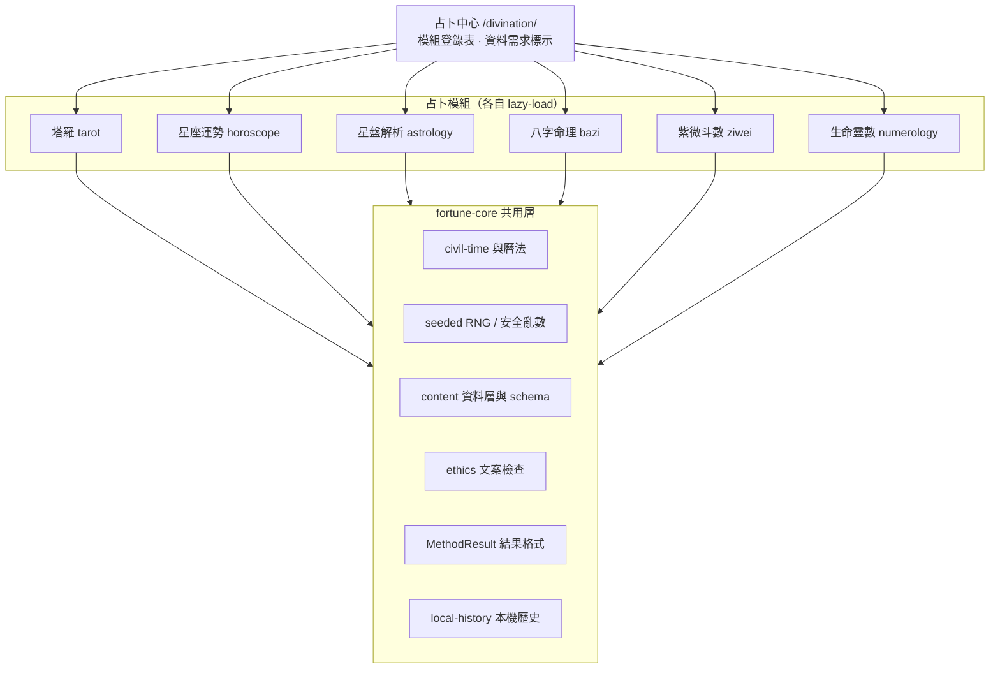

# 占卜中心 Fortune Hub 規劃

- 狀態：P0（#103）、P1（#105）、P2（#107）、P3（#109）已合併；P4 體驗與維運已實作，尚未提交（見 §9.2）
- 日期：2026-10-17
- 範圍：以既有「月夜占卜室」為基礎，整合六個占卜模組、共用計算引擎與資料層，並導入本機 Claude Code 占卜技能作為規格與內容來源。
- 原則：所有計算在瀏覽器本機完成；不需要付費 API 或 AI API Key；計算可重現；出生資料不儲存、不上傳。

## 1. 現況盤點

主站已有三個占卜入口，皆以本機規則計算，並以 `methodVersion` 標記版本。

| 模組 | 路由 | 目前狀態 | 主要檔案 |
| --- | --- | --- | --- |
| 塔羅 | `/tarot/` | 已完成：78 張牌、六種牌陣、單張與每日一抽；使用 `crypto.getRandomValues` 抽牌；閱讀歷史存於本機，P3 起經 `fortune-core/local-history` 匯出 | `src/vue/site/features/tarot/` |
| 八字 | `/bazi/` | 已完成：三柱（時辰未知）與四柱、十神、五行、大運；使用 `lunar-javascript`；P3 起標示 `inputPrecision` | `src/vue/site/features/divination/bazi.ts`（`bazi-local-v2`） |
| 西洋占星 | `/astrology/` | 已完成：行星落座、相位、年度流年；使用 `astronomy-engine`；時間未知時隱藏上升與宮位；P3 起標示 `inputPrecision` | `src/vue/site/features/divination/astrology.ts`、`astrology-annual.ts`（`tropical-whole-sign-v3`） |
| 占卜總覽 | `/divination/` | 入口卡片（月夜占卜室）；P3 起加入零輸入的今日總覽（今日一抽、今日星座） | `DivinationHub.vue`、`TodayOverview.vue` |
| 星座運勢 | `/horoscope/` | 已完成（P1）：五個面向與幸運指引，原創文案依 `dailySeed` 選取 | `src/vue/site/features/horoscope/` |
| 紫微斗數 | `/ziwei/` | 已完成（P2）：十二宮、十四主星、四化與大限；標準安星法，與 iztro 差異測試一致 | `src/vue/site/features/ziwei/`（`ziwei-standard-v1`） |
| 生命靈數 | `/numerology/` | 已完成（P1）：生命路徑、表達數、靈魂數、人格數、生日數與個人循環 | `src/vue/site/features/numerology/`（`numerology-pythagorean-v1`） |
| 梅花易數 | `/meihua/` | 已完成（§3.7）：時間、數字與文字起卦；本卦、互卦、變卦、體用、旺衰與應期 | `src/vue/site/features/meihua/`（`meihua-shaoyong-v1`） |
| 六爻易經 | `/liuyao/` | 已完成（§3.8）：銅錢與報數起卦；納甲裝卦、世應、六親六神、用神旺衰、動變與應期 | `src/vue/site/features/liuyao/`（`liuyao-jingfang-najia-v1`） |
| 奇門遁甲 | `/qimen/` | 已完成（§3.9）：時家拆補法排盤；陰陽遁與局數、九宮地盤、天盤九星、人盤八門、神盤八神、格局與方位評分 | `src/vue/site/features/qimen/`（`qimen-chaibu-shijia-v1`） |
| 風水命理 | `/fengshui/` | 已完成（§3.10）：八宅本命卦與八方吉凶；九運玄空飛星（四正向） | `src/vue/site/features/fengshui/`（`fengshui-bazhai-xuankong-v1`） |

既有可沿用的設計：

- 時區與 civil time 解析集中於 `timezone.ts`，已處理不存在與重複的夏令時間。
- `divination.spec.ts` 已有固定規則與版本的測試；`scripts/divination.browser.cjs` 是瀏覽器驗證入口。
- Vue Islands 架構見 [ADR-001](../architecture/ADR-001-vue-islands.md)，新模組應沿用。

## 2. 目標架構



### 2.1 模組登錄表

Hub 不寫死卡片，改由一份登錄表（manifest）描述每個模組：

```ts
interface FortuneModule {
  id: 'tarot' | 'horoscope' | 'astrology' | 'bazi' | 'ziwei' | 'numerology';
  title: string;
  route: string;                 // 既有 URL 保留，SEO 不變
  inputNeeds: 'none' | 'birthdate' | 'birth-datetime-place';
  methodVersion: string;
  load: () => Promise<unknown>;  // 動態匯入，確保 Hub 首屏維持輕量
}
```

Hub 依 `inputNeeds` 顯示「不需個資，立即抽牌」或「選擇資料完整度」。塔羅與星座運勢不需出生資料，應排在最前面。

## 3. 模組規格

### 3.1 塔羅 Tarot（既有，改為使用共用層）

- 輸入：牌陣、主題、問題（皆可略過）。
- 引擎：沿用 `tarot.ts`，抽牌繼續使用安全亂數；「每日一抽」維持既有行為（同一天不換牌，抽過的結果保存在本機），不改用可預測的日期種子。
- 資料：78 張牌義以 `tarot.ts` 為唯一來源。
- 驗證：以 `claude-tarot` 的 `cards.json`（MIT）做牌名與正逆位交叉比對，不複製其圖片（見第 6 節）。

### 3.2 星座運勢 Horoscope（新增）

- 輸入：星座（可由生日推算）、期間（今日／本週／本月）、日期。
- 引擎：太陽星座由日期邊界推算；內容由 `dailySeed(date, sign, period)` 選取文案組合。
- 內容：五個面向（整體、感情、事業、財務、健康）＋幸運指引與每日提示。每個面向由「情境句 × 行動句 × 語氣句」組合，避免重複感。
- 文案規則：賦權而非預測、可能性而非確定性、負面資訊附帶方向；禁止死亡、疾病確定性與恐嚇性語句（由 `ethics` 檢查器自動測試）。
- 不使用 LLM 即時生成；內容以離線撰寫、人工審稿後存為 JSON。

### 3.3 星盤解析 Astrology（既有，擴充）

- 引擎：沿用 `astronomy-engine` 與 `tropical-whole-sign-v3`。
- 擴充：星盤 SVG 圖形、行星逆行狀態、相位表說明、年度流年摘要。
- 精確度標示：每張盤顯示「完整／近似（時間未知）／僅太陽星座」，與八字共用同一套 `inputPrecision`。
- 驗證：挑選數個日期，與公開星曆（如 JPL Horizons）的行星黃經比對，寫入 golden 測試。

### 3.4 八字命理 BaZi（既有，維持）

- 引擎：沿用 `bazi.ts`（`bazi-local-v2`）與 `lunar-javascript`。
- 保留：三柱模式（時辰未知）、真太陽時更正（須明確開啟）、大運性別與流派參數。
- 擴充：流年與大運的時間軸視覺化；十神說明文案移至 `content` 層。

### 3.5 紫微斗數 Ziwei（新增，需先做技術 spike）

需要：農曆日期、時辰、五行局、紫微星定位、十四主星安星與四化。

兩條路線：

| 路線 | 做法 | 優點 | 風險 |
| --- | --- | --- | --- |
| A. 採用 `iztro` | 作為執行期依賴（MIT，v2.6.3） | 成熟，省開發時間 | 解包約 3.6 MB，依賴 `lunar-typescript`、`i18next`、`dayjs`，需要評估 gzip 後的體積與 perf budget |
| B. 自行實作 | 依規則文件實作純函式引擎；以 `iztro` 作為 devDependency 的對照表做差異測試 | 體積小、可控、可重現 | 開發成本較高，需大量 fixture |

建議：先做 spike，比較兩條路線的 gzip 體積與 10 組以上命盤的差異；若 B 的差異可收斂，採用 B，並以 A 作為測試對照。無論哪條路線，都要統一使用 `lunar-javascript` 的曆法來源，避免同時引入兩套農曆庫。

### 3.5.1 Spike 結果（P2，已決定路線 B）

- **體積**：`iztro` 2.6.3 以 esbuild 打包（含 `lunar-typescript`、`i18next`、`dayjs`）約 503 KB（未壓縮），gzip 約 147 KB。路線 B 的 `/ziwei/` 島嶼 gzip 約 8 KB，曆法沿用既有的 `lunar-javascript` 共用層。
- **差異**：標準引擎與 iztro 在 12 組陽曆命盤、1 組農曆換算命盤，以及 5 個五行局 × 30 日的紫微落宮表上完全一致。差異測試位於 `ziwei.iztro.spec.ts` 與 `ziwei.spec.ts`。
- **規格文件偏差**：`ziwei-fortune` 技能的 `calculation-rules.md` 與 iztro 有三處不一致，因此計算不採用其規則，只作規格參考。
  1. 五行局的命宮天干誤用農曆月份。例如庚午年五月初八亥時，命宮在未，命宮干支應為癸未（楊柳木，木三局），不是壬未。
  2. 紫微落宮的奇偶進退與起算方式不同。例如木三局初八，iztro 與標準引擎為卯，技能規則算出子。
  3. 紫微與天府的對稱軸是寅申，不是子午。例如紫微在卯，天府在丑。
- **決定**：採路線 B，以標準安星法實作，iztro 只作為 devDependency 的對照表（`iztro` 2.6.3，MIT）。執行期程式碼不載入 iztro。

### 3.6 生命靈數 Numerology（新增）

- 輸入：出生日期；可選全名。
- 計算：生命路徑數、表達數、靈魂數、人格數、生日數，加上個人流年／月／日。主數 11、22、33 不化約。
- 中文姓名：字母對照需要拼音表，列為待決定事項（見第 10 節）；P1 階段先只使用出生日期。
- 所有計算步驟可展開顯示，方便使用者自行驗算。

### 3.7 梅花易數 Meihua（新增）

- 輸入：起卦方式（時間、數字或文字）與問題方向（一般、感情、事業、財運、健康）；起卦不需要出生資料。問題文字只顯示在結果標題，不儲存。
- 起卦：時間起卦以本機時間換算農曆，上卦數為年支序數加月加日，下卦數再加時支，動爻為全數取餘 6；數字起卦依一至三個數字；文字起卦以常用字筆畫（僅收錄常用字，未收錄者提示改用數字）。取餘為 0 時取 8 或 6。
- 推導：本卦由上下卦組成；互卦取二至四爻為下卦、三至五爻為上卦；變卦將動爻陰陽互換。體卦為不含動爻的半卦，用卦為含動爻的半卦；互卦與變卦各自取用卦所在的半卦，與體卦比較。
- 斷卦：體用五行生克（用生體、體生用、用克體、體克用、比和）決定大方向；旺衰以本月月令（農曆月近似，未以節氣精算）判斷體卦力度；應期依體卦旺月與動爻位置給出參考。
- 來源與差異：規則整理自邵雍《梅花易數》與本機的占卜技能文件。技能文件的快速示例有三處與其公式不一致（時間示例應為地山謙而非山地剝、數字示例應為風澤中孚而非澤風大過、文字示例應為水山蹇而非山水蒙），以公式與六十四卦對照為準；時間起卦採含年支的算法，與技能文件的示例一致。
- 驗證：`meihua.spec.ts` 以公式與示例驗算卦名、互變、旺衰與時間換算；文案通過 `ethics` 檢查。

### 3.8 六爻易經 Liuyao（新增）

- 輸入：起卦方式（銅錢或報數）與問題方向（一般、求財、事業、感情男問或女問、健康、求子、出行、合作）；起卦不需要出生資料。問題文字只顯示在結果標題，不儲存。
- 起卦：銅錢法以三枚銅錢擲六次，正面枚數 3 為老陽、2 為少陽、1 為少陰、0 為老陰（動）；報數法一個數字時上下卦同取，兩個數字依序為上卦與下卦，兩數相加為動爻，餘數為 0 時取 8 或 6。
- 裝卦：八宮六十四卦依本宮、一至五世、游魂、歸魂推演；納甲以內外卦天干分配，納支依京房表（艮宮內為辰午申、外為戌子寅）；六親以所屬宮的五行為「我」；六神依日干自初爻起排。月建以節氣分月，日辰子時於 00:00 換日（與生辰八字相同）。
- 斷卦：用神依問題方向選定，有動爻優先，其次持世，再取旺衰較強者；旺相休囚死依月建地支的五行判斷（休為生旺者，死為旺所克）；日辰的生扶或克制、月破與日破會調整強弱；原神、忌神與動爻的生克沖合組成綜合方向；應期取用神五行得令之月。
- 來源與差異：規則整理自本機的六爻技能文件。該文件的艮宮納支、月建旺衰的休與死、以及六親以世爻為基準三處，與傳統京房體系不一致，本模組依傳統體系實作，並在說明中列出計算方法。
- 驗證：`liuyao.spec.ts` 檢查六十四卦名與三爻一致、八宮世應、納甲納支、六親、旺相休囚死與示例卦；`interpretation` 的文案通過 `ethics` 檢查；`LiuyaoApp.spec.ts` 掛載島嶼並驗證起卦、用神切換與輸入錯誤。

### 3.9 奇門遁甲 Qimen（新增）

- 輸入：日期與時間（以台北時間換算節氣與時辰，預設為目前時間）與問題方向（一般、出行、合約洽談、事業、財運）；不需要出生資料。問題方向只改變評分與斷語，不重新排盤。
- 節氣與局數：以 lunar-javascript 取得最近一個已過的節氣（精確到分）。冬至至芒種為陽遁，夏至至大雪為陰遁。局數依拆補法的二十四節氣表，分上、中、下三元。
- 符頭與元：節氣日起第一個甲或己日為符頭。符頭地支為子午卯酉定上元、寅申巳亥定中元、辰戌丑未定下元，之後每五日輪轉一元。
- 排盤：地盤以戊起於局數宮，陽遁順布、陰遁逆布，九個符號（戊己庚辛壬癸丁丙乙）含中五。旬首（時辰所屬甲子旬）的六儀所落宮，其本宮星與本宮門分別為值符與值使；值符星轉至時干所在宮，值使門轉至時支所在宮（子一、丑寅八、卯三、辰巳四、午九、未申二、酉七、戌亥六）；八神自值符宮起，陽順陰逆。中五無星門，天禽寄陽遁坤二、陰遁艮八，轉動時以寄宮代中五的環位。
- 斷卦：每宮分數為九星、八門與八神的分數，加上三奇（乙丙丁）與三奇遇吉門（休、生、景、開）的加分，再加上問題方向的加分；分數 3 以上為吉，−1 以下為凶，其餘為中。格局列出三奇得使、伏吟（值符移位 0）、反吟（值符移位 4）與門伏吟。
- 來源與差異：規則整理自本機的奇門技能文件與拆補法的公開資料（《奇門遁甲統宗》局數表）。技能文件的簡化用局表（例如冬至上旬一局、雨水上旬二局）與拆補表不一致，本模組依拆補表實作；「符頭定元」與「旬首定元」兩種流派有出入，本模組採符頭定元。陰遁小雪依多數來源採 5-8-2。
- 驗證：`qimen.spec.ts` 以公開的排盤例（2002 年 4 月 7 日庚辰時：己落兌七、值符天柱、值使驚門，轉至艮八與巽四）驗算排布，該例的局數依另一流派，因此測試直接以陽遁六局排布；另以手算的 2026-10-18 10:00 盤驗算陰遁六局、值符天任與值使生門；符頭日干支與 lunar-javascript 比對 120 個日期。`QimenApp.spec.ts` 掛載島嶼並驗證排盤、問題方向切換與錯誤輸入，斷語通過 `ethics` 檢查；`divination.browser.cjs` 於 390 px 驗證，`perf-budget` 設定 `/qimen/` 預算，桌面保留高度以量測值為準。

### 3.10 風水命理 Fengshui（新增）

- 輸入：出生年份（1900 至 2100）與性別；出生日期可選，填入後以農曆新年換算命年；房屋坐向可選（坐北朝南、坐南朝北、坐東朝西、坐西朝東）。計算只在瀏覽器進行，不儲存、不上傳。
- 本命卦：2000 年（含）以前，男為 10 − 數字根、女為數字根 + 5；2000 年以後，男為 9 − 數字根、女為數字根 + 6。餘數為 5 時，男為坤、女為艮。只給年份時以國曆年計算，頁面會提示；給出生日期時，新年前出生者歸入前一個農曆年（以 lunar-javascript 換算，驗證於 2005 與 1985 年春節前後）。
- 八宅：命卦固定排布八星，東四命（坎、離、震、巽）的吉方在北、東、東南、南，西四命（乾、坤、艮、兌）的吉方在西、西北、西南、東北。各命卦的八星都是全排列，且伏位與吉星位於命卦所屬的吉方。
- 八宅表的校正：技能檔的巽卦表有西方與西南重複、兌卦表缺生氣且南方重複。巽卦改為西南五鬼、西六煞；兌卦採公開來源整理的排布（生氣西北、天醫西南、延年東北、伏位西、禍害北、六煞東南、五鬼南、絕命東）。兌卦有兩個網路來源（一篇整理兌宅八方、一篇以後天卦位表示）與本表一致，但仍非《八宅明鏡》原典。乾、坤、艮的表與技能檔有出入：另一個網路來源把乾、坤、艮的生氣與天醫位置排在不同方位（例如艮命生氣西南、乾命生氣正西），且來源彼此不一，因此維持技能檔的值，列為待古籍核對。
- 玄空飛星：只收錄九運（2024–2043）與四正向。運星九紫入中宮順飛（中→乾→兌→艮→離→坎→坤→震→巽）；山星與向星依技能檔的九運坐向表飛布，逆飛反向；每宮取三星，同宮兩星依組合表加減分，總分 1 以上為吉，−1 以下為凶。斜向坐向暫不計算，因技能檔的斜向山星與向星數值無法與宮位規則對應。
- 斷語：固定規則組句，以空間布局的建議代替吉凶判語，化解方法以布置為主，不保證結果，通過 `ethics` 檢查。
- 驗證：`fengshui.spec.ts` 驗算 1985、2000、2005 與 1995 年的本命卦，檢查八宅表的排列與吉方歸屬、順逆飛路徑、九運四正向的中宮星，以及斷語的 ethics。`FengshuiApp.spec.ts` 覆蓋表單、坐向切換、範圍錯誤與過期結果提示。`divination.browser.cjs` 於 390 px 驗證。
- 限制：玄空飛星是單一流派的九運排布，不涵蓋三元其他運與斜向坐向；乾、坤、艮的八星仍待古籍核對（見上）。

## 4. 共用計算引擎與資料層（`fortune-core`）

建議放在 `src/vue/site/features/fortune-core/`，各模組只能依賴它，不得互相依賴。

| 子模組 | 職責 |
| --- | --- |
| `civil-time` | 由既有 `timezone.ts` 移入；提供 civil time 解析、夏令時間處理與地點清單 |
| `calendar` | 包裝 `lunar-javascript`：陽曆、農曆、干支、節氣；所有模組只透過此層取得曆法 |
| `rng` | `seededRandom(seed)` 供每日內容使用；`secureRandom` 供抽牌使用；兩者不可混用 |
| `content` | 內容 JSON 的 schema 與版本；以 `ajv`（已是 devDependency）在測試與建置時驗證 |
| `ethics` | 文案檢查器：掃描禁用詞、絕對化用語與缺少建設性方向的負面句 |
| `result` | 統一輸出格式 `MethodResult<T>`：`methodVersion`、`contentVersion`、`inputPrecision`、`disclaimer` |
| `local-history` | 本機閱讀歷史，含 schema 版本、匯出與一鍵刪除 |
| `ui` | `DoorCard`、`PrecisionSelector`、`ReadingCard`、`DisclaimerNote` 等共用元件 |

### 4.1 結果格式

```ts
interface MethodResult<T> {
  module: string;
  methodVersion: string;        // 例如 'bazi-local-v2'
  contentVersion: string;       // 文案版本，文案改動時遞增
  inputPrecision: 'full' | 'approximate' | 'minimal';
  disclaimer: string;
  data: T;
}
```

每個結果都標示版本，讓使用者能知道「這個結果是用哪一版規則算的」，也讓 golden 測試能偵測規則漂移。

## 5. 隱私、倫理與成本

- 出生資料只存在記憶體，計算後不寫入 `localStorage`；若要記住，需使用者逐次勾選同意，且可一鍵刪除。
- 閱讀歷史只存於本機，不上傳；若要分享，只分享文字結果，不附出生資料。
- 不使用任何付費 API；不需 AI API Key；不呼叫第三方占卜服務。
- 每個模組顯示一致的免責說明：內容供娛樂與自我反思，不保證事件，不取代醫療、法律或財務建議。
- 文案由 `ethics` 檢查器在 CI 中把關。

## 6. 導入占卜相關技能

### 6.1 已安裝到本機的技能（`~/.claude/skills/`）

| 技能 | 來源 | 用途 |
| --- | --- | --- |
| `fortune-hub` | fortune-telling-skills | 占卜路由規則與資料收集流程參考 |
| `tarot`（Claude Tarot） | claude-tarot（MIT） | 牌名與正逆位交叉比對 |
| `tarot-reading` | fortune-telling-skills | 牌陣與解讀規則參考 |
| `horoscope-daily` | fortune-telling-skills | 星座面向與文案結構參考 |
| `numerology-fortune` | fortune-telling-skills | 生命靈數計算規則與數字意義參考 |
| `ziwei-fortune` | fortune-telling-skills | 紫微斗數計算規則（路線 B 的規格來源） |
| `bazi-fortune` | fortune-telling-skills | 八字規則交叉比對 |
| `vedic-astrology` | fortune-telling-skills | 本計畫範圍外，保留為未來擴充模組 |
| `fengshui-advisor` | fortune-telling-skills | 已實作為 §3.10 的模組，技能文件只作規則參考 |
| `meihua-yishu`、`liuyao-yijing`、`qimen-dunjia` | fortune-telling-skills | 已實作為 §3.7、§3.8、§3.9 的模組，技能文件只作規則參考 |

這些技能是給 Claude Code 使用的提示與規則文件，**不是網站的執行期程式庫**。網站執行時不載入它們。

### 6.2 使用方式

- **規格來源**：計算規則（例如紫微的排盤步驟、生命靈數的對照表）作為實作與測試的參考，由工程師讀後自行撰寫程式碼。
- **內容撰寫**：星座文案可在 Claude Code 中以這些技能協助起草，但最後必須經人工審稿，才寫入 `content` 層。
- **交叉驗證**：`claude-tarot` 的 `cards.json` 作為牌名與正逆位的比對資料，寫成測試。

### 6.3 授權閘門（實作前必須確認）

- **fortune-telling-skills**：README 顯示 MIT 授權標章，但 repo 內**沒有 LICENSE 檔案**。在作者確認前，只把其內容當成規格參考，不直接複製文字或文案。
- **claude-tarot**：MIT 授權，若複製 `cards.json` 等資料，需保留版權聲明與授權全文。
- **claude-tarot 的圖片**：授權與來源不明，**不匯入**。站內已有自製的 `assets/tarot-cards/` 圖卡。

## 7. 優化建議（已納入規劃）

1. **統一輸入精確度**：八字的時辰未知、占星的時間未知、紫微的時辰未知，共用 `inputPrecision`，避免各模組各自定義。
2. **模組登錄表與 lazy-load**：Hub 只載入卡片，點進模組才載入引擎；`lunar-javascript` 與 `astronomy-engine` 各自成為共用 chunk。
3. **Perf budget 新增占卜路由**：為 `/divination/` 與新模組路由在 `scripts/perf-budget.browser.cjs` 設定預算，依既有流程記錄提高理由。
4. **Golden 測試與版本號**：每個引擎以固定 fixture 做 snapshot；規則改變時必須遞增 `methodVersion`，否則測試失敗。
5. **每日內容用種子亂數**：「今日運勢」以 `dailySeed(date, sign, period)` 選取文案，同一天同一星座不會看到不同結果，重新整理也不會換內容。種子可由他人推算，因此只用於娛樂文案，不用於抽牌或任何需要隨機性的場合。
6. **統一本機歷史**：塔羅歷史與未來的其他結果共用 `local-history`，含 schema 版本、匯出與一鍵刪除。
7. **文案 CI 檢查**：`ethics` 檢查器進入 `npm run check`，禁用詞一旦出現就失敗。
8. **離線支援**：將 `/divination/` 與各模組路由加入既有的 PWA 離線快取（`scripts/site/pwa.cjs`）。
9. **跨模組「今日總覽」**：今日運勢與每日一抽都不需要出生資料，可在 Hub 首頁合併成一張「今日卡片」，零輸入即可使用。
10. **無障礙**：所有模組支援鍵盤操作、`prefers-reduced-motion` 與對比檢查，並納入 `scripts/visual-audit.cjs`。
11. **分享只分享結果**：若提供分享功能，只輸出文字或不含個資的圖片，避免把出生日期與位置一起傳出去。
12. **SEO 與搜尋**：新路由加入 `data/catalog.json` 或對應的頁面清單，並出現在 sitemap 與站內搜尋。

## 8. 測試策略（TDD）

每個模組依序完成：

1. **Schema 測試**：內容 JSON 通過 `ajv` 驗證，版本欄位存在。
2. **Golden 測試**：固定輸入產生固定輸出（含 `methodVersion`）。紫微與占星另以外部對照做差異測試。
3. **邊界測試**：閏月、夏令時間重複與空缺、子時跨日、日界線（星座與生命靈數）、無效日期。
4. **倫理測試**：所有文案通過 `ethics` 檢查器。
5. **瀏覽器測試**：擴充 `scripts/divination.browser.cjs`，覆蓋輸入、結果、歷史刪除與離線模式。
6. **效能與視覺**：perf budget 與 visual audit 通過。

既有 `npm run check` 會執行 typecheck、Vitest 與建置，新模組需納入其中。

## 9. 分階段路線

| 階段 | 內容 | 驗收 |
| --- | --- | --- |
| P0 基礎 | `fortune-core`：civil-time 移入、calendar 包裝、rng、content schema、ethics、result、local-history；Hub 改為登錄表 | 既有三模組行為不變；既有測試全數通過；首屏 bundle 不增加 |
| P1 新模組（可平行） | 軌道 A：生命靈數（純計算）；軌道 B：星座運勢（內容與引擎） | 各自 golden、schema、ethics 測試通過；lazy-load 生效 |
| P2 紫微 | spike（路線 A／B 比較）→ 實作 → 差異測試 | 10 組以上命盤與對照結果一致或差異有記錄；體積在預算內 |
| P3 整合 | 既有塔羅、八字、占星改用共用層；統一歷史與精確度標示；今日總覽 | 行為與既有測試一致；歷史可匯出與刪除 |
| P4 體驗與維運 | Hub 視覺改版（暗黑童話主題）、離線快取、perf budget、visual audit、文件更新 | `npm run check:all` 通過 |

P1 的兩個軌道與 P2 的 spike 彼此獨立，只依賴 P0 的共用層，檔案範圍互不重疊，可各自在獨立工作區進行。

### 9.1 P3 實作結果

- **共用層**：塔羅閱讀歷史改由 `fortune-core/local-history` 提供；storage key 維持 `lucas-lab:tarot-history:v1`，既有紀錄不需遷移。`local-history` 新增保留順序的 `update`；寫入失敗改為往上拋，讓 UI 能正確告知「未保存」，讀取與清除仍不拋錯。
- **精確度**：八字與占星結果新增 `inputPrecision`，共用 `InputPrecision` 型別；時間未知為 `approximate`，時間齊全為 `full`。結果頁以 `fortune-core/ui/PrecisionBadge.vue` 顯示同一套標示。
- **歷史匯出與刪除**：塔羅紀錄可匯出為 JSON（只含牌卡、時間與筆記）；清除紀錄維持原有行為。
- **日期一致**：`localDayKey` 移至 `fortune-core/civil-time`，星座運勢與塔羅每日一抽共用同一個本機日期。
- **今日總覽**：占卜中心首頁新增「今日總覽」，今日一抽（已抽則顯示牌名）與今日星座（記住上次選擇的星座，只存於本機）。塔羅歷史與星座運勢引擎都以動態匯入載入。量測（gzip）：`/divination/` 入口 chunk 約 3.5 KB；總覽掛載時就會載入塔羅歷史與牌卡資料約 10.8 KB（每次進入首頁都會）；選擇星座後才載入星座引擎約 4.8 KB。這些數字留給 P4 設定 perf budget 時參考，目前尚未設定預算。
- **範圍外**：八字與占星仍不保存閱讀紀錄，因為出生資料不儲存（§5）；因此統一歷史目前只包含塔羅。單筆刪除未實作，清除紀錄涵蓋刪除需求。

- **P4 體驗與維運（已實作，未提交）**：
  - **離線**：`scripts/site/pwa.cjs` 預快取 `/divination/` 與六個模組頁面的 HTML，並把入口的 dynamic import（今日總覽的塔羅歷史、牌卡與星座引擎）一併預快取。`scripts/divination.browser.cjs` 新增離線案例：在首頁取得控制後離線開啟占卜首頁與紫微頁。
  - **靜態預渲染與版面穩定**：占卜首頁的靜態 HTML 與 Vue 島同結構，文案與門卡來自 `hub.json`，樣式抽成 `divination-hub.css`。掛載前頁面即已排版、連結無需 JS 即可使用；掛載造成的版面位移由 CLS 0.25 降為 0。
  - **Hub 視覺**：暗黑童話主題，加入月相圖示、星點背景與門卡漸層金框；不改動模組內頁。
  - **Bundle 修正**：`lunar-javascript` 改以 `manualChunks` 獨立（`vite.config.mts`）。原因是 CJS 模組的共用 runtime helper 被放進該 chunk，使塔羅與占卜首頁各下載約 300 KB 原始資料。量測（傳輸量，未壓縮）：`/divination/` 524 → 226 KB、請求 16；`/horoscope/` 489 → 191 KB。
  - **Perf budget**：`scripts/perf-budget.browser.cjs` 新增 `/divination/`（272 KB、19 個請求，兩個寬度實測 226 KB、16 個請求，約 20% 餘裕）。
  - **Visual audit**：`scripts/visual-audit.cjs` 的路由與截圖加入占卜首頁與五個模組路由。
  - **其他島嶼頁的版面穩定**：horoscope、numerology、ziwei、bazi、astrology 在 assets/style.css 以 `min-height` 保留掛載後的高度（390、768、1440 px 實測，四捨五入到 10 px），掛載後 CLS 為 0，並已加入 perf budget。這是保留空間的做法，掛載前的空白區域會較大；若要移除空白，需要像占卜首頁一樣做靜態預渲染。
  - **tarot 靜態預渲染**：原因是掛載後的版面（英雄區、牌陣選擇、牌庫）比靜態殼層高很多，桌機寬度 CLS 約 0.33。改為在建置時以 Vue SSR 產生島嶼的首屏標記（`src/vue/site/tarot-ssr.ts`、`vite.tarot-ssr.config.mts`、`scripts/render-tarot-static.mjs`），寫入 `/tarot/` 靜態頁。元件的 scoped 樣式已隨入口 CSS 在 `<head>` 載入，且輸出含相同的 `data-v-*` 屬性，因此掛載後 DOM 與樣式不變，1440 與 390 px 的 CLS 皆為 0。量測（傳輸量）：527 KB、23 個請求，perf budget 設為 640 KB、28 個請求。限制：若訪客本機已有閱讀紀錄，「最近的牌陣」區塊於掛載後才出現，仍會造成位移；靜態標記無法得知本機紀錄。
  - **視覺稽核**：`npm run test:visual` 已通過（234 個頁面與視窗）。先前的 `label-content-name-mismatch` 以替換 aria-label 的方式修正，範圍包括站頭、工具卡、閱讀器字級按鈕、藝廊、遊戲章節卡與音效按鈕、音樂曲目列與片段按鈕；遊戲與閱讀器測試的選擇器已同步更新。
  - **相依性**：`@axe-core/playwright` 4.14.0 已加入 `package.json` 的 devDependencies（`npm install --save-dev`），視覺稽核不再需要額外安裝。`playwright` 1.64.0 同樣加入 devDependencies，與沙箱版本一致，瀏覽器測試不再需要 `NODE_PATH`。

## 10. 待決定事項

1. **紫微路線**：A（`iztro` 執行期依賴）或 B（自行實作、`iztro` 僅作測試對照）？建議先做 spike，依體積與差異結果決定。
2. **中文姓名的生命靈數**：是否建立拼音對照表？建議 P1 先只用出生日期，姓名功能待拼音表確定後再加入。
3. **星座文案來源**：自撰模板並人工審稿（建議），或先用技能協助起草再審稿？
4. **站名**：維持「月夜占卜室」，或改為「占卜中心 Fortune Hub」？兩者可並存，Hub 頁顯示其一即可。
5. **fortune-telling-skills 授權**：是否向作者確認 MIT 授權？確認前只作規格參考。

## 11. 影響範圍

- 本文件為規劃文件，**不修改任何既有程式碼、資料或建置設定**。
- 實作時預計影響：`src/vue/site/features/`（新增 `fortune-core/`、`horoscope/`、`ziwei/`、`numerology/`，調整 `divination/` 與 `tarot/`）、`src/vue/site/divination-main.ts`、`scripts/site/`（頁面與 PWA）、`scripts/perf-budget.browser.cjs`、`scripts/divination.browser.cjs`、`data/catalog.json`、`package.json`（若採用 `iztro`）。
- 版本與授權變更需在 `docs/IMPLEMENTATION.md` 記錄；若採用 `iztro`，需新增依賴說明。
