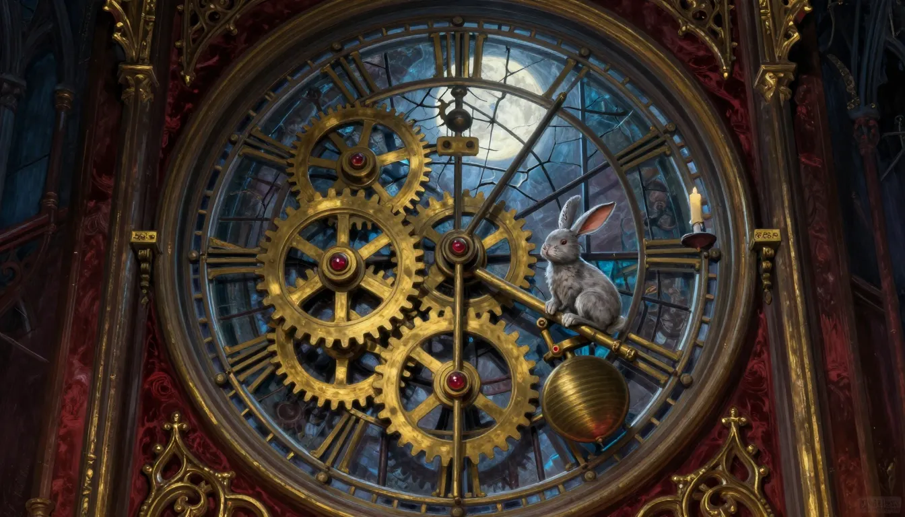
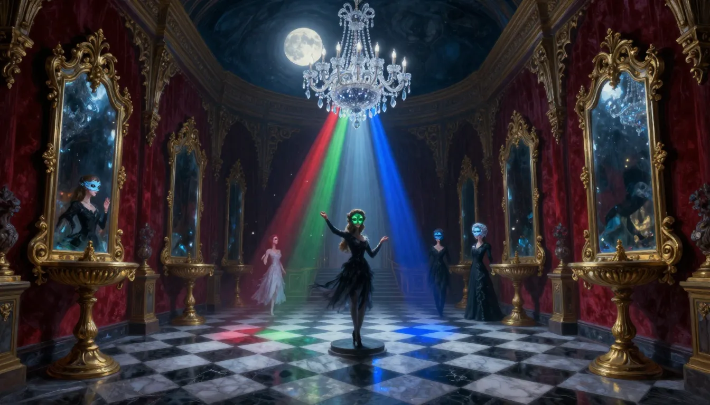
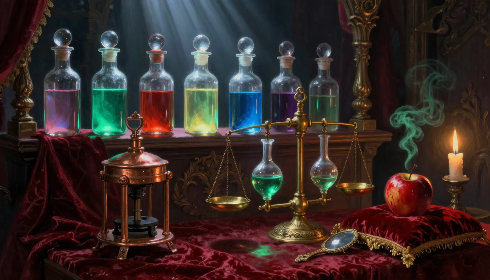
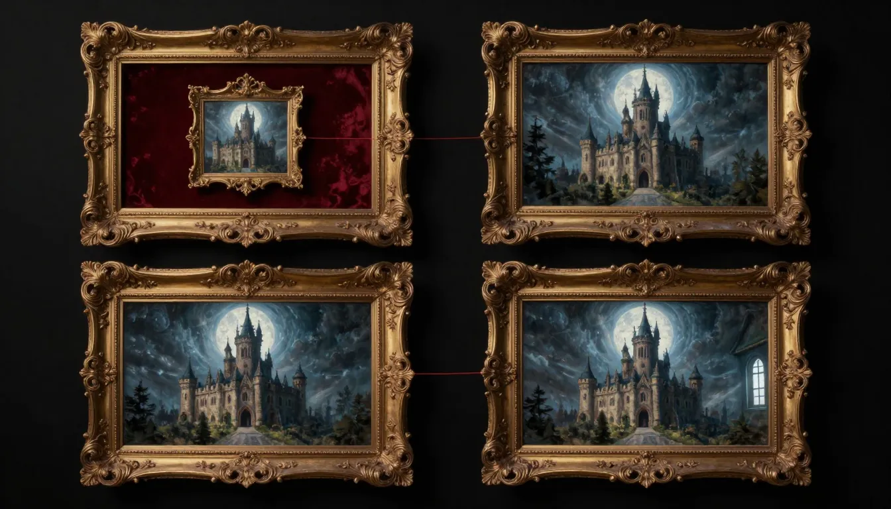
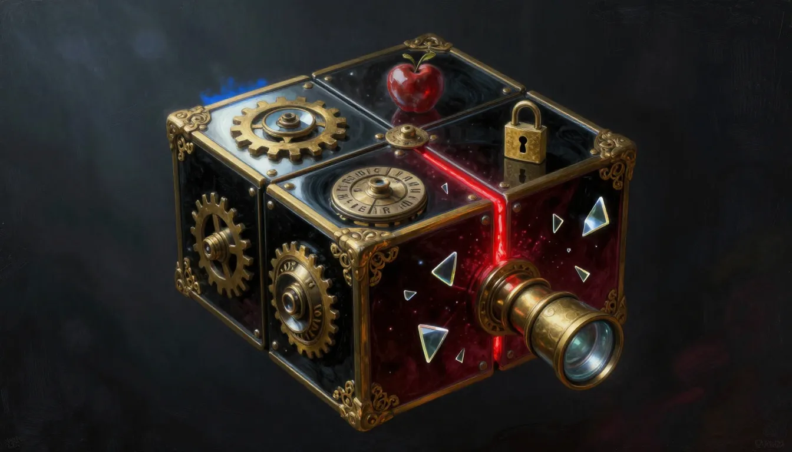

# 《血色魔鏡》專家關卡「鏡淵」企劃（決策已確認，原型階段）

- 日期：2026-10-14
- 狀態：**E1、E2、E3 已實作為正式選修關卡，含正式美術（E1 見 7.8、7.9 節，E2 見 7.10 節，E3 見 7.11 節，2026-10-14）；E4–E5 仍是原型（E4 正式版規劃與 v3 原型見 [`plan-e4-formal.md`](plan-e4-formal.md)）。** 企劃、概念圖與 E1–E5 五個原型已完成（第 7.1–7.5 節）；**第 7.1–7.7 節與第 8 節記錄的是 E1 實作前的狀態（當時沒有修改任何遊戲程式、資料或已發布素材）。** 第 7 節決策 D1–D7 已採用建議，D7（對照原著稿件）已於 7.6 完成，**3 項必須修改與 4 項措辭修正都已套用**到企劃與原型（E3、E5、E2 文字）。原型只經過腳本與瀏覽器點擊驗證，**尚無真人手機觸控試玩**。原型說明見 [`prototypes/README.md`](prototypes/README.md)。
- 範圍：`games/blood-mirror/` 新增一組高難度選修關卡；網站其他頁面僅在介紹文案連動。
- 配套素材：概念圖 `plan-improve/concepts-expert/`（6 張，本機 Z-Image Turbo 產生，**僅供方向參考，不是正式素材**）。PNG 母檔放在 `../draft/lucas-lab/blood-mirror/concepts-expert/`，不進版本控制。

---

## 1. Executive summary

- **判定：needs-work（企劃可進入確認，不可直接開工）。** 設計稿的預估總分 **0.73**（6 維度預估值，非實測，見第 3 節）；現有七幕在 2026-10-12 的評估為 0.62（`plan-improve.md` §14.4）。
- **一句話標題：** 現有 13 個機關多為單層的拼圖或排序，難度上限約 0.85；「鏡淵」把難度拉高的方式不是加大數字，而是**多層套疊、跨機關相依、可由程式驗證唯一解**，並以《The Room》《Gorogoa》《The Case of the Golden Idol》《Return of the Obra Dinn》為參考。
- **提案：** 通關任一結局後開放「鏡淵」——魔鏡記帳留下的「帳本的背面」。5 關，每關 12–20 分鐘（首玩估計），最後一關把前四關的成果合成一個多面魔鏡匣。另有 1 關選配的「喘息關」。
- **最大風險：** 第 4 關（巢狀畫面）的美術成本與手機操作精度；建議先做原型再決定是否保留（第 5 節 R2）。

## 2. Inputs & assumptions

**需求原文：** 白雪公主遊戲；設計難度更高、美術精美媲美可上市遊戲的關卡；可參考熱門密室逃脫的機關；先規劃關卡與想法並產圖示意，確認後再實作。

**現況（已讀程式與文件）：**

| 項目 | 現況 |
|---|---|
| 結構 | 序章＋七幕＋尾聲；13 個機關（`puzzles/*.js`，每個 20–100 行）；每幕 4–5 格填空審問；鏡之碎片 7 片，集滿開祕密尾聲 |
| 提示 | 每個機關、推理與封印各有三層提示；已知瓶頸停滯 3 分鐘魔鏡主動提示 |
| 約束 | 零相依、嚴格 CSP（禁行內 `style`）、離線、無時間限制、可鍵盤與觸控；點陣圖單檔 ≤ 500 KB、`dist/games` ≤ 26 MB（`scripts/check.cjs`，現有素材 `assets/` 約 16 MB，剩餘約 10 MB）；既有測試 `scripts/blood-mirror-level.test.mjs` 檢查軟鎖與熱點間距 |
| 美術語言 | 暗紅絲絨、古金巴洛克、冷月藍；油畫質感寫實光影 |

**假設（需確認）：**
1. 玩家已通關主線，熟悉熱點、物品欄、燭光、提示系統；專家層不再教學基本操作，只教「新機關」。
2. 「更高難度」＝首玩 12–20 分鐘／關、需要紙筆級推理的機關，**不是**加時間限制或隨機性（現有設計支柱：沒有時間壓力）。
3. 劇情以「帳本的背面」延伸（魔鏡記帳留下的底稿，不假設魔鏡仍存在），不改寫原著已有結局；新增設定已對照 `content/` 的稿件（見 7.6）。
4. 所有時長與難度數字都是設計假設，需 3 位真人試玩校正（延續 `playlog.js`）。

## 3. Multi-dimensional score（設計稿預估，非實測）

評分依 `puzzle-escape-room-design` 的六個框架；這是**設計階段的自評**，用來決定先補哪裡，真人試玩前不得當成事實。

| 維度 | 框架 | 預估 | 依據 |
|---|---|---|---|
| 心流適配 | Flow theory (Csikszentmihalyi) | 0.70 | 每關第一層為暖身層（沿用懷錶暖身做法 r9），挑戰逐層升高；但專家層沒有自適應，只靠提示回收 |
| 謎題設計品質 | Schell 鏡頭／Bogost | 0.78 | 每關一個「看似簡單、答案出人意料」的核心（齒輪、光、液、畫面套疊、匣）；機關可與其他機關互動（惰輪、濾鏡、鏡面） |
| 難度曲線 | 先教後考 | 0.75 | 暖身→並行二選一→合流→meta；喘息關放在第 2、3 關之間 |
| 流程結構與瓶頸 | 流程結構與瓶頸分析 | 0.70 | 每關兩條並行支線再合流，避免單線卡死；第 5 關為多線匯聚，是唯一的全域瓶頸 |
| 可解性與歧義 | 可解性／歧義檢查 | 0.72 | 規劃每個機關附離線解題器證明唯一解／最短解；歧義風險在第 3 關的邏輯陳述與第 4 關的對齊容差 |
| 提示與失敗狀態 | 提示與失敗狀態設計 | 0.70 | 沿用三層提示與停滯低語；加入 Obra Dinn 式「分組確認」防暴力試錯，不扣分、不重來 |
| **總分** | | **0.73** | 六項平均 0.725 |

**挑戰紀錄（devil's advocate；本稿沒有 ≥ 0.8 的維度，僅針對高影響行動）：**

| 目標 | 反方論點 | 處置 |
|---|---|---|
| roadmap:r2 第 4 關巢狀畫面 | 精準對齊在手機上容易失敗；每個畫面需要手工對齊的多層美術，成本遠高於其他關 | **降級為「原型先行、可砍」**：先做 1 個 beat 的原型，通過手機試玩與美術成本評估才進入正式製作；替代方案是把它改成第 6 節的「影戲關」 |
| roadmap:r1 離線解題器 | 解題器證明的是「規則下唯一」，不保證人類看得懂線索 | **保留，但不單獨當作驗收**：解題器之外仍需要 3 位真人試玩看「卡關位置」 |
| roadmap:r4 追加美術預算 | AI 單張圖無法拆成可動零件，預算與品質可能都不達標 | **保留並明寫限制**：採「繪製底圖＋SVG／Canvas 動態機件」混合管線（第 5 節 A） |

## 4. Findings

### 4.1 設計總覽：鏡淵（Mirror Abyss）

**入口：** 通關任一結局後，七片鏡之碎片帶出「帳本的背面」——原著稱魔鏡是「王國的帳本，也是王國的墳墓」，這是它記帳留下的底稿。每一幕的場景都有一個「底稿房間」，與正面的物件對稱但規則不同。解開一關，取得一件**專家獎勵**（時辰環、稜鏡、回魂藥、紅線、匣面符號），供最終的魔鏡匣使用。

**共通規則：**
- 每關四層：**L1 暖身層**（教這關的新機關，幾乎不可能失敗）→ **L2 並行二選一**（兩個機關互不相依，卡住可換）→ **L3 合流層**（需要兩條線的產出）→ **L4 小 meta**（得出該關的獎勵與一個字／符號，供最終關使用）。
- **防暴力試錯：** 答錯不扣分、不重來，但回饋只說「差一點」或「第 k 項說不通」，不顯示正確數；需要多格答案的，一次確認 3 格（Obra Dinn 的做法）。
- **提示：** 沿用三層 `stepHints`；每層都在「燭光」中給觀察方向，不給答案。
- **無障礙：** 所有拖曳都有鍵盤替代；`prefers-reduced-motion` 時改為立即切換；顏色謎題一律附形狀或符號第二通道（光路的紅綠藍同時有三角、圓、方）。
- **可驗證：** 每個機關寫成純資料規則＋一支 Node 測試，用暴力搜尋證明「有解、解唯一（或最短解長度）」，納入 `npm run check`。

### 4.2 難度與節奏

| 關 | 強度（預估 0–1） | 角色 | 估計首玩 |
|---|---|---|---|
| E1 逆走鐘樓 | 0.65 | 專家層的暖機；機關新、規則透明 | 12–15 分 |
| E2 稜鏡舞廳 | 0.75 | 空間推理；唯一解由求解器保證 | 14–18 分 |
| E-X 影戲小屋（選配） | 0.50 | **喘息關**：低壓力的觀察／旋轉 | 8–10 分 |
| E3 毒蘋果調配室 | 0.85 | 邏輯＋狀態空間＋色彩，三種思考切換 | 15–20 分 |
| E4 無限鏡廊 | 0.90 | 視覺空間的「頓悟」，美術即謎題 | 15–20 分 |
| E5 七重魔鏡匣 | 1.00 | 前四關的合成與密碼 | 20–25 分 |

合計 76–98 分鐘（含喘息關約 84–108 分）。曲線是鋸齒上升，先教後考：E1 的惰輪→E5 的匣面齒輪盤；E2 的鏡面反射→E4 的鏡中之鏡；E3 的鏡中反寫（沿用第七幕反寫手稿）→E5 的密碼盤。

### 4.3 五個關卡

> 每張示意圖是**方向稿**：用來確認構圖、材質與氛圍，不是最終遊戲畫面。實作時可操作的機件會以 SVG／Canvas 另行繪製。

#### E1《逆走鐘樓》— 齒輪與第十三聲

- **場景：** 不在學院十二座鐘塔之列的第十三座鐘塔機房，入口在地下書庫的暗門之後（原著：第十三聲代表有人使用禁忌魔法）。巨大黃銅機芯、鐘盤背面的 13 格星輪、擺錘、紅寶石軸承、一支蠟燭。灰兔玩偶（正式稿需補上右耳縫線）坐在齒輪軸上，當作暗示：序章的兔子在這裡回收。
- **參考機關：** 《The Room》的機芯與多層暗格；密室逃脫常見的齒輪傳動謎題。
- **L1 暖身：** 兩枚齒輪連動，加一枚「惰輪」，讓玩家看到惰輪只改旋轉方向、不改比例。
- **L2-A 齒輪列：** 曲柄（固定 12 齒）要讓輸出軸**同方向**每轉 1 圈，曲柄轉 **13 圈**。軸座位置固定，只有兩組中心距：25.5 與 15（單位＝模數）。備用齒輪：6、8、12、13、16、18、24、39 齒。
  - 驗算：12→39 的減速比 3.25，同軸 6→24 再減速 4，總比 13；中心距 (12+39)/2 = 25.5、(6+24)/2 = 15，**與兩組軸座吻合**；兩次嚙合各反向一次，輸出與曲柄同向。
  - 干擾項：8→24（比 3）、13→39（比 3）、16→… 等，用「差一點」的比例誘導，**中心距限制**才是排除的線索（玩家要自己算）。
  - 驗證：求解器列舉所有可放置組合，證明滿足「比＝13、同向、中心距吻合」的配置唯一。
- **L2-B 鐘擺相位：** 擺錘長度可由三塊配重調整；舊鐘擺的刻痕說「擺兩次，鐘響一次」。玩家需推得擺長要變為四倍才能使週期加倍（週期與擺長平方根成正比，線索以刻度與觀察呈現，不直接寫公式）。
- **L3 合流：** 兩道機關的輸出推動 13 格星輪；用燭光（沿用既有長按）才看得見星輪邊緣的刻字，指出第 13 格的動作。
- **L4 小 meta：** 第 13 格暗格取出「時辰環」（密碼盤的一圈）與一個注音符號。
- **反暴力：** 齒輪可放置的組合只有兩個軸座；錯誤時只說「轉得動／卡住」，不顯示比例。
- **技術：** Canvas 或 SVG 繪製齒輪，嚙合以齒數計算角度即可，零相依。

#### E2《稜鏡舞廳》— 光、鏡、顏色

- **場景：** 凝結的舞會；水晶吊燈（原著：封著 108 隻不停燃燒、尖叫、沒有人聽得見的火精靈）把一道月光分成紅、綠、藍三束，三束光是火精靈的火；鏡面立在可旋轉的底座上；凍結的賓客面具眼窩嵌著寶石。
- **參考機關：** 密室逃脫的雷射反射／光路謎題；現有第二幕「鏡面光路」的進階版。
- **規則：**（顏色同時有形狀第二通道）
  - 光束沿格線直行；鏡子可旋轉 8 個方向（每 45°，只用 `/`、`\` 兩種反射面時為 4 態）；濾鏡把白光變單色；**合光水晶**使交會的兩束光相加（紅＋綠＝黃，紅＋藍＝洋紅，綠＋藍＝青，三者＝白）；賓客是阻擋物，可用腳下的轉盤推動一格。
  - 目標：3 個面具各要求一種顏色，其中一個要求**黃**（必須同時送入紅與綠）。
- **L1 暖身：** 單束紅光，一面鏡，一個面具。
- **L2-A 三原色分流：** 多束光、兩面濾鏡，先確定每個面具對應的光。
- **L2-B 賓客與轉盤：** 移動賓客讓路，讓兩束光在合光水晶交會。
- **L3 合流：** 同一個盤面同時滿足三個面具與一個黃色。
- **L4 小 meta：** 三個面具亮起後，吊燈落下一枚**稜鏡**（一隻火精靈的核心；解開時玩家第一次聽見它們的尖叫）——它在最終關變成「目鏡」，可以看穿匣面的隱藏層（致敬《The Room》的目鏡）。
- **驗證：** 盤面狀態空間小（鏡 6 面 × 4 態 × 賓客位置），離線窮舉，保證唯一解並計算最短步數；若有多解則調整盤面，不放行。
- **反暴力：** 光路即時顯示，不需要「提交」；答錯無懲罰但沒有解題提示線——避免單純旋轉就能通關，鏡數與賓客位置設計成**單步無法看出進展**。
- **技術：** Canvas 逐格追蹤光束；顏色混合是 RGB 加法，零相依。

#### E3《毒蘋果調配室》— 邏輯、液位、鏡中的配方

- **場景：** 王后的祕密藥房：銅製蘋果榨汁機、黃銅天平、三個以管線相連的玻璃量杯、七個發光的瓶子、玻璃罩下的紅蘋果、一面手持鏡。
- **參考機關：** 邏輯瓶謎題（經典「七瓶、真假陳述」題型）、水壺量測（狀態空間搜尋）、《Case of the Golden Idol》的「用詞彙推理」。
- **L1 暖身：** 三個瓶子、三句陳述、一瓶有毒（單解）。
- **L2-A 七顆蘋果的證詞：** 七顆蘋果各附一名**藥房學徒**（原創角色：白芷、遠志、決明、茯苓、紫蘇、杜仲、甘松；不使用原著的礦工）的陳述（鏡面反寫，需用手持鏡閱讀；沿用第七幕反寫手稿的操作），條件是「除了拿著毒蘋果的人說謊，其餘六人說實話」。驗證器證明只有一位使全部證詞成立。
- **L2-B 回魂藥量杯：** 三個量杯（容量 8／5／3，初始 8 滿）以單向管線相連（A→C→B→A）。目標：取得恰 4 單位的蘋果汁原液。驗證用廣度優先搜尋，證明最短解長度並確認無捷徑（「每倒一次改變閥門」的原規則實測無解，見 7.4）。
- **L3 合流：** 回魂藥要染成配方的色。配方色只在**手持鏡的反射**中才準確（玻璃有綠色偏色），玩家用三個滑桿調色，容差有明確的視覺回饋（逐漸清晰，不顯示數值）。
- **L4 小 meta：** 取得「回魂藥」物品——毒蘋果「讓呼吸停止、意識進入魔鏡」（`data/items.js`），回魂藥是它的反向，讓意識從鏡中回到身體；另得一個注音符號（來自持有毒蘋果的學徒編號）。
- **反暴力：** 蘋果指認一次確認 3 顆（Obra Dinn 式），不顯示哪一顆錯；量杯每一步可「復原」，不計步數。
- **歧義風險：** 邏輯陳述的措辭要逐句校對（Golden Idol 試玩曾因逗號歧義卡關），納入文字審查清單。

#### E4《無限鏡廊》— 巢狀畫面（簽名關，風險最高）

- **場景：** 四幅鍍金畫框組成的 2×2，各是同一座城堡的不同尺度；第一幅裡的一面小鏡子映出第二幅；一條紅線穿過各幅。
- **參考機關：** 《Gorogoa》——可拖動、堆疊、放大縮小的畫格，靠視覺對齊解題（「門口對齊後角色走進另一格」「星星拖進燈籠」）。這個機制和「鏡」的主題最貼。
- **操作：** 拖曳畫格換位、疊放（上層有透明孔）、放大到物件內、縮小回外層。鍵盤替代：方向鍵移動焦點畫格、`Enter` 疊放、`+`／`-` 縮放。
- **5 個 beat（每個 beat 是一個小謎題，後者依賴前者）：**
  1. **對齊：** 走廊畫格的鏡子「映出」陽台畫格；把兩格疊起讓門框重合。
  2. **放大：** 放大鏡中的陽台，窗內是庭院畫格的縮小版。
  3. **穿越：** 把紅線從庭院「拉」到王座廳的燈上（對齊兩個門口）。
  4. **反轉：** 把一格翻面（鏡像），讓陰影的方向與另一格一致。
  5. **合一：** 四格疊成一個畫面，紅線連成完整圖案，得到一個符號。
- **驗證：** 每個 beat 定義為「錨點對（A 格的點、B 格的點、容差）」，離線腳本證明在所有可能的拖放組合中僅一種滿足全部錨點；容差定為畫面短邊的 4%（手機約 12–15 px）。
- **主要風險：** 每個畫格需要**事先對齊**的美術（AI 單張圖無法保證門口位置一致）。對策見第 5 節 A：以「圖像編輯模型」固定構圖＋SVG 覆蓋層校準；仍然超出預算時改用 E-X。

#### E5《七重魔鏡匣》— 終章：合成與密碼

- **場景：** 懸浮在黑暗中的多面魔鏡匣，黑鏡玻璃與古金；六面各有一個機關；七片鏡之碎片環繞；前景是一枚黃銅目鏡。
- **參考機關：** 《The Room》的終局匣（每面用不同工具、目鏡看見隱藏層）；《Rusty Lake》的跨章伏筆；密室逃脫的密碼盤。
- **六個面：**
  | 面 | 需要 | 機關 |
  |---|---|---|
  | 1 時辰面 | E1 時辰環 | 13 格撥盤，設定開啟時間 |
  | 2 光之面 | E2 稜鏡（目鏡） | 透過稜鏡看見面上隱藏的刻線 |
  | 3 蘋果鎖 | E3 回魂藥 | 蘋果形的鎖，滴入回魂藥開啟 |
  | 4 鏡中鏡 | E4 紅線 | 把紅線穿過兩個鏡孔，轉動匣面 |
  | 5 碎片面 | 主線 7 片鏡之碎片 | 每片碎片記得七十三個孩子之中的一個名字，依編號嵌入各自的位置（完成度不足時只能嵌入已收集的，不硬性鎖死） |
  | 6 密碼盤 | 四個注音符號 | 解讀王后留在匣內的字條（明文「露西」） |
- **密碼盤：** 以**注音符號**（37 個）做移位密碼，密鑰是 E1–E4 各取得的一個符號（共 4 個，維吉尼亞式）。讀者是台灣玩家，注音有在地感且不易被搜尋；驗證器確認解密結果唯一且不是亂碼。（備案：改用符文環，見 D6）
- **結局：** 匣打開後進入「帳本的背面」的祕密尾聲（新的一幕）；完整結局的匣底另有一行小字「ㄒㄩㄝ（雪）」——呼應薇菈遺言「為什麼雪是白色，我不知道，希望妳以後自己找到答案」（第十八章）。
- **防軟鎖：** 玩家可略過某一面（保留「提示後仍可通關」的保底），但完整結局需要六面。
- **這一關也是唯一的全域瓶頸**，所以要有最完整的三層提示與停滯低語。

### 4.4 選配：E-X《影戲小屋》— 喘息關

- **機制：** 旋轉燈前的木雕（兩軸滑桿或拖曳），讓牆上投影與目標剪影吻合——《Escape Academy》《Escape Simulator》與實體密室都常用的「影子謎題」。
- **用途：** 難度 0.5，放在 E2 與 E3 之間，讓高強度關卡中有一次低壓力的觀察與旋轉。
- **成本：** 木雕可用 2D 多層疊圖或簡單的 3D 投影（Canvas 手算旋轉，零相依）；比 E4 便宜得多，也是 E4 被砍時的替代方案。

## 5. Improvement roadmap（排序依 `priority`）

| id | 行動 | 工作量 | 影響 | priority | 目標 | 框架 |
|---|---|---|---|---|---|---|
| r1 | 為每個機關寫純資料規則＋離線解題器（證明有解、唯一、最短解），納入 `npm run check`；擴充 `blood-mirror-level.test.mjs` 檢查專家層軟鎖 | 中 | 高 | 1 | solvability 0.72 → ≥ 0.85 | 可解性與歧義檢查 |
| r2 | **原型先行**：E4 一個 beat、E1 齒輪列、E2 光路各做一個可玩原型，在手機與桌面各測一次，決定是否保留 | 中 | 高 | 2 | 風險 R1–R3 | 流程結構與瓶頸分析 |
| r3 | 建立專家層的提示表：每機關三層＋停滯低語＋「分組確認」回饋 | 小 | 高 | 3 | hint 0.70 → ≥ 0.80 | 提示與失敗狀態設計 |
| r4 | 美術管線（下方 A）：每關 1 張底圖＋SVG／Canvas 機件＋光影層；音效逐機關 | 大 | 高 | 4 | 「可上市」的完成度 | 謎題設計原則（Schell 鏡頭：美學與回饋） |
| r5 | 3 位真人試玩：每機關耗時、卡關位置、是否看得懂線索；用 `playlog.js` 校正強度曲線 | 中 | 高 | 5 | 校正第 3 節所有預估 | 心流理論 |
| r6 | 決定喘息關 E-X 是否納入；若 E4 原型未通過，以 E-X 取代 | 小 | 中 | 6 | 曲線 0.75 | 難度曲線與先教後考 |

### A. 美術與「媲美上市」的實際做法

先說清楚限制：**AI 單張圖只能當方向稿，不能直接當可玩的機關。** 要達到上市品質，每關需要：

1. **底圖＋可動機件分層：** 底圖由 Z-Image／圖像編輯模型出稿（沿用 AIPS 素材流程與人工審查 PASS／REVISE）；機件（齒輪、鏡面、量杯、畫格）以 SVG／Canvas 繪製，加上金屬漸層、陰影與環境光，才能嚙合、旋轉、反射。
2. **光影與粒子：** 燭光的動態遮罩、體積光、塵埃粒子、鏡面反光；Canvas 2D 即可，不引入框架；`prefers-reduced-motion` 關閉動態。
3. **音效：** 每個機關操作都有機械音；現有 `soundtrack.js` 與 `juice.js` 可擴充。
4. **一致性：** 沿用既有色票（暗紅、古金、冷月藍）與 `design-board` 的框線；角色臉部用既有立繪作參考圖，不重新生成。
5. **預算：** 單張點陣圖 ≤ 500 KB；`dist/games` 上限 26 MB、現有約 16 MB，剩餘約 10 MB。5 關每關約 1.5–2 MB（底圖 2–3 張＋縮圖）約 8–10 MB，**接近上限**，需要懶載入（沿用機關懶載入）並可能調整上限（D5）。

## 6. Sources & limitations

### 6.1 Sources

| # | 來源 | 用途 | 證據等級 |
|---|---|---|---|
| S1 | [Critical Play: The Room](https://mechanicsofmagic.com/2026/05/06/critical-play-the-room/) | 「揭露隱藏狀態」比「排列零件」更能帶來發現感；巢狀盒＋目鏡 | 評論（單一評論者的詮釋） |
| S2 | [Design Critique: The Room（Pratt SI）](https://ixd.prattsi.org/author/arch/) | 觸控操作的物件感與回饋 | 學生設計評析 |
| S3 | [Gorogoa Review（bit-tech）](https://www.bit-tech.net/reviews/gaming/pc/gorogoa-review/1) | 2×2 畫格、疊放、縮放、巢狀；暴力試錯風險 | 遊戲評論 |
| S4 | [Critical Play – Gorogoa](https://mechanicsofmagic.com/2026/05/08/critical-play-gorogoa-5/) | 對齊式謎題與視覺引導（breadcrumbing） | 評論 |
| S5 | [Pursuing the "Aha!" moment — The Case of the Golden Idol（Game Developer）](https://www.gamedeveloper.com/design/case-of-the-golden-idol) | 推理遊戲設計；在指引量上取捨；文字歧義風險 | 開發者訪談 |
| S6 | [5 deduction games（Boss Rush）](https://bossrush.net/2025/02/these-5-deduction-based-games-make-you-feel-like-a-genius-detective/) | Obra Dinn 以分組確認抑制暴力試錯 | 評論 |
| S7 | [Escape room design（CVUT 課程講義）](https://courses.fit.cvut.cz/NI-ESC/lectures/files/esc-room-design.pdf) | 密室流程與機關類型的教學大綱 | 課程講義 |
| S8 | [49+ DIY escape room puzzle ideas](https://teachingideas.ca/2023/07/02/escape-room-puzzle-ideas/) | UV、液體、密碼盤等常見機關；階梯式提示 | 教學部落格（等級最低，僅作機關清單參考） |
| S9 | 專案內：`plan-improve/plan-improve.md` §14.4–14.5、`puzzles/index.js`、`scripts/check.cjs`、`data/chapters/*.js` | 現況、約束與既有機制 | 一手程式與文件 |

### 6.2 Limitations（必讀）

- **知識庫過期：** `SECOND-KNOWLEDGE-BRAIN.md` 的最後更新是 2026-07-01，已超過 7 天；本次以即時搜尋補充，但沒有執行 `tools/knowledge_updater.py`。評分是對 105 天前的知識快照加上本次 4 次搜尋所得。
- **搜尋涵蓋不足：** 沒有找到鏡面雷射、天平的專門來源，也沒有找到提示系統與失敗狀態的開發者資料；這些機關的設計是我依經驗與專案現有規則推導，**不是有引用的結論**。
- **未執行驗證器：** 本稿沒有產生完整的 `harness-io` JSON，也沒有跑 `tools/harness_validator.py` 的三道關卡；第 3 節的分數是自評，不是機器驗證的結果。
- **數字都是假設：** 時長、強度、容差（4%）、齒輪參數、量杯容量等需要原型與真人試玩確認；解題器尚未寫，「唯一解」目前只是設計目標，不是事實。
- **概念圖不是成品：** 6 張由本機 Z-Image Turbo（9 步、8-bit、1344×768）產生，沒有經過 AIPS 正式素材審查。逐張檢視結果：
  - E1：氛圍與材質到位；**灰兔右耳沒有縫線**（需改）、齒輪沒有真的嚙合（實作時以 SVG 重繪）。
  - E2：光束、鏡框與棋盤格地板的方向正確；賓客的臉與手需重修，鏡面倒影為隨機內容。
  - E3：用色與物件組合可用；蘋果、鏡子的位置只是示意。
  - E4：**只傳達了「四個畫框＋紅線」的構圖，沒有傳達「對齊」玩法**——四幅城堡太相似，無法看出疊放後該對齊什麼；這張需要重做，也是 E4 風險最高的證據。
  - E5：構圖最強，但匣面只露出三面、機關為示意；密碼盤上的刻字是亂碼，正式稿要自繪。
  - E-X：剪影與光影最好；木雕本體在畫面外，需補。
- **原著設定已對照**（7.6）；仍待對白定稿與作者審稿。新增的原創角色（七名藥房學徒）、「帳本的背面」「回魂藥」是本企劃的提案，不是原著內容。

## 7. 待確認的決策

| # | 問題 | 建議 |
|---|---|---|
| D1 | 專家層的入口：通關任一結局後開放，還是與主線穿插／以鏡之碎片逐關解鎖？ | 通關後開放；每關需要 1 片碎片，兼顧「收集」的動機 |
| D2 | 關卡數：5 關，或 5 關＋喘息關（共 6）？ | 納入喘息關 E-X（成本低，且是 E4 的備案） |
| D3 | 目標難度：偏「資深解謎玩家」（本稿預設）或「一般玩家也能完成」？ | 維持專家層，但提示要完整，不得有無提示的死路 |
| D4 | E4 巢狀畫面是否批准做原型？ | 批准原型；原型未通過就改用 E-X |
| D5 | 資產預算：維持 `dist/games` 26 MB，或調高？ | 先維持，懶載入；超過再議 |
| D6 | 最終密碼：注音符號，或符文環？ | 注音（在地、不易搜尋）；符文環為備案 |
| D7 | 新設定是否沿用，是否需對照原著後再定稿？ | 先對照 `content/` 稿件，再寫入對白（**已完成，見 7.6，並已套用修正**） |

## 7.1 決策與 E4 原型紀錄（2026-10-14）

D1–D7 全部採用建議（D7＝先對照原著稿件再寫對白，已於 7.6 完成並套用）。E4 原型：[`prototypes/e4-panels.html`](prototypes/e4-panels.html)，單檔、零相依、不進發布。

- **範圍：** 3 個 beat（疊放對齊、點鏡子放大、放大狀態下對齊鏡中的光）；拖曳、點擊、鍵盤（方向鍵、`Enter`）；容差 4% 與 8% 切換；對齊提示圈。用 SVG 簡圖，不含正式美術。
- **已驗證（瀏覽器窗格，約 617 px 寬）：** 三個 beat 可由真實拖曳與點擊走完，主控台無錯誤；此寬度下 4% 容差約 7 px，兩次拖曳的誤差分別是 0.3 與 2.9（板面單位，容差 8）都通過。
- **尚未驗證：** 真實手指觸控（只測了滑鼠式拖曳）、窄手機直式版面、beat 4–5（翻面鏡像、四格合一）、鍵盤流程只寫未測。
- **初步發現：** 縮放後的對齊是在「放大後的畫面座標」比對，玩家要在放大的 A 上看著鏡中光、同時拖動未放大的 C，兩者尺度不同，需要試玩才知道是否直覺；容差在手機約 4–7 px，偏小，建議正式版預設 6%、保留「輔助」到 8%。
- **v1 試玩回饋（使用者，2026-10-14）：** 「圖像看不出物件是什麼」「無法依照提示完成任務」。原因是 v1 用抽象 SVG 色塊、目標只寫「拱門對準門」，畫面上看不到拱門與門。**這是對 beat 1 的直接證據：對齊謎題的線索必須是畫面裡一眼認得出的具體物件。**
- **v2 修正：** 改用遊戲內真實美術（鏡廊、陽台、黑松林、舞廳），目標改為肉眼可辨的「月亮對月亮」「提燈對鏡中月亮」；每步一句白話指示；金色脈動圈標出要移動的點、白色虛線圈標出目標；拖曳時顯示即時引導線，進入容差變綠；放開時 1.5 倍容差內自動吸附。圖片以內嵌方式放進單檔，直接開啟即可。這些輔助比正式版強，正式版要依層次逐步撤掉（燭光提示才顯示）。v2 尚待使用者重新試玩確認。
- **結論：** 機制可行，尚不能決定保留。是否保留 E4 要等真人手機試玩與正式美術的對齊成本評估（r2）。

### 7.2 E1 齒輪列原型紀錄（2026-10-14）

[`prototypes/e1-gears.html`](prototypes/e1-gears.html)（玩法）＋ [`prototypes/e1-gears.solve.cjs`](prototypes/e1-gears.solve.cjs)（解題器）。吸取 E4 的教訓：目標與操作先用白話寫在畫面上，齒數直接標示，咬合／空轉／卡住用顏色與文字即時回饋。

- **規則：** 5 個軸座、2 層（金＝下層、銅＝上層，只有同層會咬合；同軸上下層同轉）、8 個備用齒輪；模數 1，節圓半徑＝齒數／2；中心距＝兩齒數和的一半才咬合，更近則卡住，更遠則空轉。曲柄 12 齒固定，輸出軸在 S2，目標是 13:1 且同向。
- **解題器（已執行）：** 窮舉所有齒輪放置，**只有 1 組最小解**：S1 下層 39、S1 上層 6、S2 上層 24。三個典型近似錯誤都不成立：12／18 組合得 8:39、24／6 組合得 16:13、8／24 組合因中心距不符而卡住。
- **瀏覽器驗證：** 正確解答顯示通過；故障組合顯示「卡住」並標紅；轉動曲柄 1.51 圈時輸出 0.12 圈（＝1.51／13）；主控台無錯誤。以腳本呼叫 DOM 點擊走過「選齒輪、選層、點軸座、取下」流程，**未用真實手指或滑鼠拖曳測過**。
- **發現：** 這一版的難點只有「中心距決定齒數」，窮舉搜尋空間雖大但人只要看軸座距離就能推出，**難度偏低**（約 0.4，低於企劃的 0.65）。要提高難度可以：把軸座距離預設隱藏（現在是按鈕才顯示）、加入需要惰輪改變轉向的第二段目標、或讓輸出需要反向。鐘擺（L2-B）與星輪合流層尚未做。
- **試玩回饋（使用者）：** 「層」的概念看得懂；**不增加難度，但要增加提示**（採用，上述加難度方向不做）。
- **提示（已加）：** 「燭光提示」按鈕，兩個階段（第一段：曲柄旁的軸座；第二段：上層接力）× 三層（看哪裡 → 規則 → 答案），提示依盤面階段切換並在階段改變時重置；閒置 60 秒魔鏡自動給第一層（原型為了測試縮短，正式版維持 3 分鐘）；顯示已用提示次數供試玩統計；解出後提示消失。`e1-gears.solve.cjs` 另驗證提示內容與唯一解一致（39、6、24、4 倍、軸座距 15 的兩倍）。
- **待試玩：** 是否看得懂「層」的概念（本版最可能卡住的點）、手機上點軸座的精度。

### 7.3 E2 光路原型紀錄（2026-10-14）

[`prototypes/e2-optics.html`](prototypes/e2-optics.html)（玩法）＋ [`prototypes/e2-optics.solve.cjs`](prototypes/e2-optics.solve.cjs)（解題器）。依 E4／E1 的教訓：目標與規則寫在畫面上、顏色之外有形狀（▲紅 ●綠 ■藍，黃＝▲＋●）、燭光提示一開始就內建。

- **三關：** 第 1 關一束紅光＋一面鏡（教反射）；第 2 關紅＋綠在面具上重疊成黃（教合光，這是新規則）；第 3 關 9×7 盤面、7 面鏡、2 位可推動的舞者、3 個面具（紅、藍、黃）。
- **規則修正：** 面具**不吸收光**，光穿過面具繼續前進（初版設成吸收，一道光只能服務一個面具，黃色面具需要的紅光就不夠用，產生器因此一個解都找不到）。代價是「多餘的光照到面具」會顯示「顏色太多」，成為新的推理線索。
- **解題器（已執行）：** 三關各自只有 **1 組光束解**。第 3 關有 4 個鏡子／舞者狀態組合通過，差別只在有一面鏡子沒有任何光束經過（誘餌鏡），光束與亮起結果完全相同。每關初始狀態都不是解。
- **提示：** 由唯一解推導，三層：哪個面具還沒亮對、需要什麼顏色 → 是鏡子還是舞者的問題 → 指出要轉哪一面或推哪一位；誘餌鏡不會被提示。解題器驗證依第 3 層提示逐步修正，第 1、2、3 關分別 1、2、7 步內收斂；閒置 60 秒魔鏡自動給第一層（正式版 3 分鐘）。
- **瀏覽器驗證：** 三關透過點擊鏡子與舞者通過，第 3 關顯示取得稜鏡，主控台無錯誤；已把面具畫在光束下方，讓光束看得出穿過面具。**沒有用真實手指測過。**
- **發現：** 第 3 關狀態空間只有 2⁹＝512，真人逐面試轉也能暴力過關，**難度偏低**；若要提高，可加入濾鏡、更大盤面或「單步看不出進展」的設計（企劃原意），本版沒有。這是否需要，等試玩再決定（使用者在 E1 已表示不加難度、要加提示）。
- **尚未做：** 濾鏡、合光水晶、轉盤推動賓客、稜鏡落下後的目鏡效果；美術（現為示意圖形）；音效。

### 7.4 E3 調配室原型紀錄（2026-10-14）

[`prototypes/e3-apothecary.html`](prototypes/e3-apothecary.html)（玩法）＋ [`prototypes/e3-apothecary.solve.cjs`](prototypes/e3-apothecary.solve.cjs)（解題器）。三個小謎題各自附白話目標與三層提示（沿用 E1／E2 的做法）。

- **A 七人證詞：** 除拿毒蘋果的人說謊，其餘六人說實話；證詞是鏡中反寫字，按「舉起手持鏡」才正著讀。解題器證明**只有 1 位**（甘松，第 7 位學徒）使全部證詞成立，每個錯誤指認都至少破壞一條證詞。指認錯誤時回饋「如果是他，某人的某句會變成謊話」，不是只說錯。
- **B 回魂藥量杯：** 目標 B 杯剛好 4。**企劃的「每倒一次改變閥門」規則實測無解**（窮舉 7 種閥門翻轉規則，只有無限制的經典版有解），因此改成**單向管線 A→C→B→A**。窮舉：最短解 8 步、**最短解唯一**、可達狀態只有 16 個、**沒有走進死路的狀態**。
- **C 調色：** 紅黃藍色精各 0–4 滴，瓶子是平均色；配方色隔著綠玻璃看會歪，按「舉起手持鏡」看真色。窮舉：只有 1 組配方（紅 1、黃 1、藍 4）進入容差（8），最接近的錯誤配方距離 16.4，超過容差 1.5 倍。回饋有「很接近／有點接近」與條狀接近度。
- **提示：** 三關各三層；A 的第二層舉出一個被排除的具體例子，B 的第二、三層依目前盤面重算最短解的下一步，C 的第三層給配方。解題器驗證每個可達盤面的提示都能產生（驗證時抓到並修掉一個錯誤：盤面已達標時 B 的提示會崩潰；另修正一句錯誤的提示「同比例也可以」，因為滴數上限 4 使加倍超出範圍）。
- **瀏覽器驗證：** 以 DOM 點擊走完三關：A 錯誤與正確指認、手持鏡切換；B 以八步通關並可復原；C 逐滴調到吻合；主控台無錯誤。檢視截圖後修正了 B 的版面（C 杯文字被裁切、箭頭過短重疊、迴圈箭頭標籤壓線）。**沒有用真實手指測過。**
- **發現（偏易）：** B 只有 16 個可達狀態且無死路，一路試倒就能解；C 有接近度條，可以一滴一滴往上爬；A 只有 7 個選項。依你在 E1／E2 的回饋（不加難度、要提示），**本版沒有加難度**，但也**沒有做企劃的「3 格一組確認」防暴力機制**；是否要補，等試玩決定。
- **無障礙缺口：** C 靠顏色比對，色覺差異的玩家只能依接近度條與文字回饋；正式版需補一個非顏色通道（例如明度／色相的刻度）。
- **2026-10-14 調整**：證詞重寫、錯誤回饋只指一句並加劃掉記事本、調色改方向詞與形狀記號；細節與驗證見 [`plan-e3-formal.md`](plan-e3-formal.md) 第 9 節。上方「A 只有 7 個選項」「C 有接近度條」兩項描述是調整前的狀態。

### 7.5 E5 魔鏡匣原型紀錄（2026-10-14）

[`prototypes/e5-box.html`](prototypes/e5-box.html)（玩法）＋ [`prototypes/e5-box.solve.cjs`](prototypes/e5-box.solve.cjs)（驗證腳本）。範圍：六面的**樞紐與合成邏輯**；每一面的機關只做最小版（示意用），因為 E1–E4 已各自有原型。

- **結構：** CSS 3D 立方體（點任一面或 ◀ ▶ 轉動）、物品欄（顯示 E1–E4 取得的道具、鑰匙符號與線索）、「試玩用」勾選（可模擬缺少某個道具、收集 0–7 片碎片）。缺道具的面顯示「🔒 缺道具」並說明該回哪一關取得。
- **六面：** 時辰面（撥盤停在 13）、光之面（舉起稜鏡才看得到刻線：▲紅■藍●綠的順序）、蘋果鎖（選第 7 顆，答案來自 E3 的線索）、鏡中鏡（紅線依星、月、燈、門穿孔）、碎片面（碎片編號對位置，缺的可留空）、密碼盤。
- **密碼盤：** 注音 37 符號移位密碼。鑰匙＝四關各給的一個符號（E1 ㄎ、E2 ㄒ、E3 ㄋ、E4 ㄧ），密文「ㄖㄑㄙㄥ」，明文「ㄌㄨㄒㄧ」（露西，不標聲調）。畫面附 1–37 編號表，每個字用「往回數」計數器（−5／−1／＋1／＋5），並即時顯示讀出的字。
- **驗證腳本（已執行）：** 37 個符號無重複；加解密可還原；**四個鑰匙任一個換成別的符號，結果都不是「ㄌㄨㄒㄧ」**（缺任何一關都無法解開，沒有捷徑）；每個字只有一個往回數的格數能得到對的明文；每一面（碎片面除外）無道具即打不開、密碼盤缺任一關的鑰匙都打不開；每面有三層提示且最後一層寫出答案；各關給的線索與該面的答案一致。
- **瀏覽器驗證：** 以 DOM 點擊走完六面（含錯誤輸入的回饋）、六面全開後顯示完整結局；另測缺稜鏡＋只有 3 片碎片：光之面與密碼盤顯示鎖定與回關提示，三層提示後出現「略過」，略過 2 面後匣子仍可開啟並顯示縮減結局。主控台無錯誤。**沒有用真實手指測過，也沒有轉動 3D 立方體的視覺驗證（只看到了正面視角）。**
- **試玩中修正：** 密碼盤的計數器原本只有 ±1，ㄧ（35）要點 35 下，加了 ±5。
- **發現與風險：**
  - 這一關**依賴前四關的內容才成立**：目前 E1 的 ㄎ、E2 的 ㄒ、E4 的 ㄧ 都是我指定的，E1–E4 的原型並沒有真的把這些符號發給玩家（只有 E3 有注音符號輸出）；正式製作時要回頭補。
  - 解碼需要玩家自己理解「往回數」，提示第三層才給步驟，**最可能卡關的就是這裡**。
  - 「略過」讓玩家不被單一面卡死，但也讓結局分成完整與縮減兩種，內容量要多寫一份。
  - 時長、難度仍是假設；沒有試玩資料。

### 7.6 D7：新設定對照原著稿件（2026-10-14）

對照 `content/stories/dark-snow-white.md`（20 章＋序章＋尾聲）與遊戲現有資料（`data/chapters/*.js`、`data/items.js`、`data/endings.js`、`data/secret-epilogue.js`）。標記：✔ 與原著一致、➕ 遊戲原創且不衝突、⚠ 與原著或遊戲設定衝突。

| # | 企劃的新設定 | 對照結果 | 建議處理 |
|---|---|---|---|
| 1 | 「第十三聲」與鐘樓機房（E1） | ✔ 原著第一章：學院只有 **十二座** 鐘塔，第十三聲代表有人使用禁忌魔法。⚠ 小處：原著的書庫在**地下最深處**，企劃寫「書庫上方的鐘樓機房」 | 改成「不在十二座鐘塔之列的第十三座機房，入口在書庫暗門之後」；它就是第十三聲的來源 |
| 2 | 灰兔（右耳縫線）出現在鐘樓（E1） | ✔ 第十四章：白雪最喜歡的灰色兔子，右耳總會掉，每次醒來都被重新縫好，原來是薇菈縫的 | 保留，且是加分：縫線可以成為薇菈來過的暗示；不要在 E1 揭露是誰縫的（第十四章才揭露） |
| 3 | 時辰環、13 格星輪、惰輪／齒輪列（E1） | ➕ 原創，與原著無衝突（原著有黃金懷錶，機制已被第一幕使用） | 保留；星輪第 13 格可呼應懷錶「偷走別人的分鐘」 |
| 4 | 水晶吊燈落下稜鏡、三色光（E2） | ✔ 第三章：吊燈封著 **108 隻火精靈，不停燃燒、尖叫，沒有人聽得見**。⚠ 企劃把吊燈寫得像單純的光學裝置，與原著的殘酷基調不合。面具是遊戲原創（原著舞會沒有面具），但遊戲第二幕已採用 | 把三束光改為火精靈的火；稜鏡是一隻精靈的核心；解開後讓玩家「聽見」尖叫（原著寫「沒有人聽得見」）。面具保留 |
| 5 | 王后的祕密藥房（E3） | ✔ 第十八章：薇菈原本是白雪母親的**醫師**——藥房很合理 | 保留場景 |
| 6 | 七個礦工各拿一顆蘋果、其中一人下毒，**提米是下毒者**（E3、E5 線索） | ⚠ **衝突**：七個礦工是被王室害成矮人的受害者與白雪的同伴；尾聲提米成為會計師、全員存活；第四幕七個名字已用礦工做座位謎題。讓提米下毒會毀掉角色，且與第四幕重複 | **必須改**：七位持有者改為原創角色（例：薇菈的七名藥房學徒／七位宮廷醫官），名字另取；E5 蘋果面的線索與注音符號依新名單重做 |
| 7 | 「毒蘋果」與「解藥」（E3、E5） | ⚠ 原著與遊戲的毒蘋果不是殺人毒藥：**讓呼吸停止、意識進入魔鏡**（`data/items.js`），由薇菈遞給白雪；沒有解藥 | 改為「**回魂藥**」：讓意識自鏡中回到身體，是毒蘋果的反向；E3 的蘋果謎題改成找出「哪一顆會把人送進鏡子」 |
| 8 | 無限鏡廊（E4） | ✔ 第十三章：「一條沒有盡頭的走廊，兩側有數千面鏡子」，鏡中是被抵押的人 | 保留，且是現成的場景描述 |
| 9 | 紅線（E4、E5） | ➕ 遊戲原創：`data/chapters/mirror.js` 已有「紅線從孩子們的腕間連到碎裂的巨鏡」。原著只有**銀色絲線**連接七座城市（第十五章） | 保留紅線（遊戲內自洽）；可在文字中讓紅線與銀絲相映，但不要混用兩個名稱 |
| 10 | 「魔鏡的背面」，通關任一結局後開放 | ⚠ 原著與遊戲的真結局：白雪交出名字後「**魔鏡碎成了灰**」；王冠結局魔鏡仍在，霜潮結局魔鏡也有碎裂描寫。「所有結局後都有背面」會與真結局矛盾。原著把魔鏡稱為「王國的帳本，也是王國的墳墓」 | 改框架為「**帳本的背面（帳底）**」：魔鏡記帳留下的底稿，由七片鏡之碎片（遊戲原創）帶出，不假設魔鏡仍存在；入口仍是通關後 |
| 11 | 露西（E5 答案） | ✔ 第十三章：八歲，七十三個孩子中最後一個，她問「我媽媽後來怎麼樣了」，原著沒有回答；終章露西帶孩子們離開。遊戲祕密尾聲「露西的母親」已補上回答 | 保留。答案「露西」與遊戲主線呼應 |
| 12 | 「王后最後一封信」（E5 密碼盤） | ⚠ 原著沒有信：薇菈的遺言是口述，並說「為什麼雪是白色，我不知道，希望妳以後自己找到答案」（第十八章）。原著有一封黃金封蠟信（第九章），不是王后的遺信 | 把「信」改為「王后留在匣內的字條」；**可選**：明文改為「雪」（ㄒㄩㄝ），呼應這句未解答的話 |
| 13 | 碎片面「七個孩子的星座」（E5） | ⚠ 原著是**七十三個**孩子；七片碎片是遊戲原創 | 文字改為「七片碎片，各記得一個孩子的名字」，不寫成七個孩子 |
| 14 | 注音符號密碼 | ➕ 不屬於原著世界（故事以中文敘述，玩家為台灣讀者） | 保留；以「王后慣用的記號」之類的說法在世界內解釋，避免出戲 |

**必須改（會與原著或遊戲衝突）：** #6、#7、#10；**建議改（措辭與細節）：** #1、#4、#12、#13；其餘保留。（以上為對照當時的發現；E3、E5 原型原本使用礦工與提米，下方「決定與套用」已全部修正。）

**決定與套用（2026-10-14，使用者「全部照建議」）：**
1. E3 七位持有者＝**七名藥房學徒**（原創：白芷、遠志、決明、茯苓、紫蘇、杜仲、甘松，為藥材名；已確認不與原著或遊戲現有角色重名）。持有毒蘋果的是第 7 位甘松，E5 蘋果面的線索同步改寫。
2. 「解藥」改為**回魂藥**（毒蘋果的反向：讓意識從鏡中回到身體），E3 原型與 E5 物品欄、提示、結局文字都已更新。
3. E5 密碼盤明文維持**露西**；「雪（ㄒㄩㄝ）」作為完整結局匣底的第二層彩蛋，已加進 E5 原型的完整結局文字。
4. 其餘修正已套用：入口改為「帳本的背面」（企劃正文與 E5 結局文字）、E1 機房位置、E2 吊燈與火精靈（E2 原型通關文字）、「字條」、碎片面「七十三個孩子之中的七片」。
5. 驗證：四支驗證腳本重新執行全數通過；E3、E5 於瀏覽器以點擊重走，新文字正確、主控台無錯誤。**對白尚未寫、新角色尚無設定，需作者審稿。**

### 7.7 對白與角色草稿（2026-10-14）

[`expert-dialogue-draft.md`](expert-dialogue-draft.md)：補齊 7.6 之後「對白尚未寫、新角色沒有設定、新設定待審稿」三件事。

- **內容：** 世界內的說法（入口、魔鏡與薇菈的聲音、注音符號的由來）、七名學徒的角色表（各一句話與蘋果卡片台詞）、入口與 E1–E5＋E-X 的開場／解封對白、E5 的完整與縮減結局。共 42 句，格式沿用遊戲的 `scene`。
- **為了不與原著衝突的做法：** 魔鏡與薇菈只以「帳冊底稿裡的聲音」出現（真結局魔鏡已碎成灰、薇菈已死）；甘松的證詞寫成「帳冊替他寫的話」，他是被寫成說謊的人，不是壞人；注音符號寫成薇菈小時候教給白雪的私人記號。
- **驗證（已執行）：** `node expert-dialogue.check.cjs`：說話者皆為既有說話者、妳從不開口、每句 ≤ 80 字（最長 43）、沒有驚嘆號、沒有原著礦工名、薇菈只說一句。E3 原型的學徒卡片台詞改由草稿同步，`e3-apothecary.solve.cjs` 驗證兩邊一致。
- **作者決定（2026-10-14，「照建議」）：** 草稿 4 節的 6 項待決全數採用預設值（學徒下場不交代、甘松抵債背景採用、簽名欄空白保留、遺言改寫不照錄、三個詞並用並訂定分工、縮減結局維持柔和），對白與角色表定稿；詞彙表見草稿 4 節。**尚未寫進遊戲**。

### 7.8 E1 正式實作紀錄（2026-10-14）

作者指示「開始做 E1 正式章節」。這是第一次把鏡淵的內容寫進遊戲，所以先走變更影響評估（AIPS Change Impact `abyss-e1`），再實作。

**架構決定：鏡淵不是第八幕。** 七幕是一條線性鏈（`engine/rules.js` 的 `rooms`＝`chapters`，通關靠最後一幕，存檔的 `roster`、`solved`、`unlocked` 都以章節索引為準）。若把專家關卡放進 `chapters`，它們會變成主線必經關卡，並改變真相計數與結局條件。所以專家關卡放在獨立清單 `data/abyss.js`，只借用既有的謎題機制：

| 項目 | 作法 | 影響 |
|---|---|---|
| 關卡資料 | `data/abyss.js`：入口對白、關卡清單（E1 的開場、解封、獎勵），台詞與對白草稿逐句一致 | 七幕、`rooms`、密度報告不變 |
| 規則與介面 | `puzzles/gears13.js`：純函式規則（`evaluate`、`solveAll`、`HINTS`）加 SVG 介面；暖身（惰輪）→ 齒輪列（13:1）兩段 | 不進首屏；首次開啟才載入 |
| 登錄 | `puzzles/index.js` 新增 `belfry`，標 `optional`：不被背景預載，新旅程重設時保留 | `resetPuzzles` 多一個條件 |
| 存檔 | 完成記錄沿用既有的 `puzzles` 清單，`engine/save.js` 的 `knownIds` 認得 `belfry`；**不升存檔版本、不新增欄位** | 舊存檔不變；未知 id 本來就會被丟棄 |
| 入口 | 首頁在**達成任一結局後**出現「帳本的背面」卡片（`index.html`、`main.js` 的 `renderAbyssEntry`）；區域本身 `abyss.js` 以動態匯入載入 | 首屏請求數維持 44（預算 45） |
| 重玩 | 通關後出現在「重玩小遊戲」（`replayOrder` 加入鏡淵關卡） | 重玩不寫回進度 |

**E1 內容（相對於企劃 4.3 與 7.2 原型）：**
- 暖身：曲柄 12 齒、中間軸座與輸出軸排成一列，托盤 8／12／16 齒；唯一解是中間放 8 齒惰輪、輸出放 12 齒。教的是「惰輪只改方向，不改速度比」。
- 齒輪列：與 7.2 原型相同的規則與唯一解（S1 下層 39、S1 上層 6、S2 上層 24）。`solveAll` 窮舉為唯一最小解。
- 正式版新增：解對後要按「轉動曲柄 13 圈」，看輸出軸轉一圈才解封（減少動態時直接完成）；軸座的點擊範圍放大（手機約 67 px 直徑）；軸座以「軸座 1」「輸出軸」「曲柄」稱呼；提示沿用 7.2 的三層，闔上盤面後自動消失；閒置三分鐘魔鏡自動給第一層。
- 獎勵：時辰環與注音符號 ㄎ（顯示在解封畫面，**不放進 `inventory`**，等 E5 實作時再由完成記錄推得）。新增一句對白：「環的內側刻著一個小記號：ㄎ。」，已補進對白草稿。
- **當時沒做的擺錘與星輪合流層，已在 7.9 補上。**

**驗證（已執行）：**
- `scripts/blood-mirror-abyss.test.mjs`（新增 8 項）：暖身與齒輪列各自唯一最小解、三個近似錯誤不成立、提示與解及盤面階段一致、齒輪外形與起始角、台詞與對白草稿逐句一致且說話者已知、關卡不在七幕內且素材 ≤ 500 KB、存檔往返與匯出匯入含 `belfry`、新旅程重設保留 `belfry`。
- `npm run check`：通過（含 139 項單元測試、密度、建置、站台檢查）；`node scripts/perf-budget.browser.cjs`：通過（遊戲首屏 44 個請求）。
- 瀏覽器（桌面與 375 px 手機寬度）：入口、清單、開場、暖身、齒輪列、解封畫面、重新載入後完成記錄仍在、重玩、重玩選單縮圖、減少動態模式；主控台無錯誤。
- **限制（當時；動畫計時與美術已在 7.9 改善）：** 瀏覽器窗格在背景時 `requestAnimationFrame` 不執行，動畫路徑改以計時器代替後驗證；**沒有用真實手指觸控試玩**；橫幅暫用概念圖裁切。

### 7.9 E1 補完：正式美術、擺錘、星輪與動畫計時（2026-10-14）

作者要求三件事：正式美術取代暫用橫幅；把當時沒做的擺錘與星輪合流做成原型再實作，並有完整、依需求給予的提示；優化背景分頁動畫不跑的問題。

**1. 正式美術。** 三道機關各產一張特寫與縮圖（本機 Z-Image Turbo，每個 2 張候選目視挑選），移除暫用的概念圖裁切。齒輪特寫的灰兔右耳有一排紅色縫線（呼應原著第十四章薇菈替小白雪縫兔子，也補上概念圖缺的那條針腳）。細節與母檔位置見 `MEDIA_ASSETS.md`。

**2. 三道機關與「合流」。** E1 現在是三道機關，順序是「齒輪列、鐘擺（先做哪一道都可以）→ 星輪」。星輪由登錄表的 `after` 擋住，要前兩道都完成才開（`puzzles/index.js`，重玩時以本輪完成為準）。

| 機關 | 規則 | 唯一解（窮舉驗證） | 提示步驟（各三層：看哪裡、規則、答案） |
|---|---|---|---|
| 鐘擺（L2-B） | 舊擺長 1 格；刻痕：「擺兩次，鐘響一次」＝新擺週期要是 2 倍；週期與擺長平方根成正比，所以擺長要 4 倍。細桿 1 格，三塊配重 0.75、2.25、1.5 格，掛上後長度相加 | 只有「輕 0.75＋重 2.25」＝4 格（週期比 2.00）；「長度加倍」的直覺只得 1.41；最近的錯誤組合週期比差 0.2 以上，容許誤差 0.04 | 尚未掛配重／太快／太慢（依玩家掛的配重切換） |
| 星輪（L3） | 13 缺口、紅寶石在頂端；缺口的數字刻字要點燭才看得見；撥爪每響一聲順時針跨固定格數，第 1 到 12 聲要依序敲在「一」到「十二」，第 13 聲落回紅寶石 | 只有步幅 5；其他 11 種步幅都在第 1 聲就被擋下；13 為質數，撥爪走遍所有缺口 | 還沒點燭／點過燭後 |

- **L3 為什麼這樣做：** 企劃寫「兩道機關的輸出推動星輪，燭光才看得見刻字」。星輪的刻字會重述前兩道的課題（曲柄十三圈、擺兩次鐘響一次），並以點燭、讀刻字、設定步幅取代需要精準時機的動作，手機與減少動態都能玩；錯誤只告訴玩家哪一聲敲到哪個數字，不懲罰。難度刻意維持低（作者「不增加難度，要增加提示」）。
- **提示（三道機關共用 `puzzles/belfry-hints.js`）：** 「燭光提示」按鈕每按一次多一層；提示依玩家目前的盤面選步驟，盤面變了就從第一層重來；解開後按鈕消失；閒置三分鐘魔鏡自動亮第一層。每個步驟的第三層都直接給出答案，由測試核對與唯一解一致。
- **原型：** `prototypes/e1-pendulum.html`、`e1-starwheel.html` 由 `build-belfry-prototypes.cjs` 從正式模組產生（規則與介面和遊戲一致，單檔、零相依），不是另寫一份。預覽窗格對本機檔案只顯示靜態快照、腳本不執行，所以這兩頁以語法檢查加正式模組在遊戲內的實測取代。
- **存檔：** 每道機關完成時記為 `belfry.<機關 id>`（沿用既有的兩段式記錄），整關完成記 `belfry`；`engine/save.js` 的 `knownIds` 由 `data/abyss.js` 的 `stages` 產生。新旅程重設時保留這些記錄。

**3. 背景分頁的動畫。** 原因：`requestAnimationFrame` 在背景分頁或隱藏窗格完全停止，轉到一半的機關會凍結。新增 `puzzles/clock.js`：每個影格同時由 `requestAnimationFrame` 與計時器排程，先到者執行；進度由經過時間計算（不是影格數），所以掉幀不會變慢。三道機關的動畫（曲柄、擺錘、撥爪）都改走它。實測：窗格隱藏時（`document.hidden` 為 true），暖身 2.9 秒、13 圈 9.4 秒完成，與 1.4 圈／秒的設定一致，不再需要替換計時器；測試核對三個模組不再直接呼叫 `requestAnimationFrame`。

**驗證（已執行）：** `scripts/blood-mirror-abyss.test.mjs` 擴充到 13 項（新增鐘擺與星輪的唯一解、近似錯誤、提示與解一致、機關素材、`after` 順序、存檔含機關記錄、計時模組）；瀏覽器以 DOM 走過三道機關、順序擋門、提示切換、減少動態與手機寬度。**限制：** 沒有真實手指試玩；鐘擺的「搖擺」節奏與星輪的敲擊節奏（0.52 秒一聲）是設計假設，需要試玩確認手感。

### 7.10 E2 稜鏡舞廳正式實作（2026-10-14）

規劃與原型見 [`plan-e2-formal.md`](plan-e2-formal.md)；原型 `prototypes/e2-prism.html` 已被正式版取代，只保留作設計紀錄。

- **結構**：`data/abyss.js` 的 `levels` 加入 `e2`（`puzzle:'prism'`，獎勵「稜鏡」與注音 ㄒ）。三道機關共用 `puzzles/prism.js`：濾鏡（`prism-rays`）、合光水晶（`prism-blend`）、舞廳（`prism-ballroom`，`after` 前兩者）。完成記錄沿用存檔 v2 的 `puzzles`（`prism`、`prism.<stage>`），不升版本。進入按鈕文字改由各關的 `enter` 提供（`abyss.js`）。
- **規則**：與原型相同（光為位元遮罩、濾鏡只放行同色、合光水晶收到兩種以上顏色才射出一束、面具不吸光、顏色之外有形狀）。盤面由 `prototypes/e2-prism.gen.cjs` 搜尋寫入，**正式版把三關的盤面直接抄進 `prism.js`**，由 `scripts/blood-mirror-abyss.test.mjs` 重新證明：三關各只有一組光束解且用到各自的新規則；第 3 關單步翻轉都不會多亮面具、兩位舞者都擋在解的光路上、起點離最近解 ≥ 4 步；提示依盤面收斂。
- **提示**：三層（哪個面具、哪一類修正、確切修正），沿用 `belfry-hints.js`；每一層文字依目前盤面即時計算（`Proxy`），不會提到玩家已修好的鏡子；閒置 3 分鐘魔鏡自動亮第一層。
- **音效**：新增 `choir`（`audio/sfx.js`，五個失諧鋸齒波加雜訊，音量約為一般提示音的 1/5，受音效開關控制），`juice.js` 補對應的輕震與血色閃光。只在舞廳通關時播放。**音量與聽感尚待作者試聽。**
- **美術**：三張橫幅與縮圖，本機 Z-Image Turbo（種子 2402、2501、2602，見 `MEDIA_ASSETS.md`）。**尚待作者驗收。**
- **順手修正（影響 E1）**：關卡選單的說明原本固定寫「兩道機關」，E1 其實有三道；改為依機關數顯示，並說明鎖住的要等前面完成。
- **驗證**：單元測試 148 項通過；用 DOM 在建置後的頁面走完入口、三道機關（舞廳在前兩道完成前顯示鎖住）、獎勵，重新載入後完成記錄仍在；手機寬度（375 px）截圖版面正常；主控台無錯誤（唯一的 404 是我自己探測時打錯路徑）。
- **尚未驗證**：**沒有真實手指試玩。** 舞廳盤面 9 欄，375 px 寬的手機上一格約 33 px，小於 44 px 的建議觸控尺寸，鏡子與舞者彼此相鄰，需真機確認是否容易點錯。

### 7.11 E3 毒蘋果調配室正式實作（2026-10-14）

規劃、原型調整與驗證見 [`plan-e3-formal.md`](plan-e3-formal.md)；原型 `prototypes/e3-apothecary.html` 已被正式版取代，只保留作設計紀錄。

- **結構**：`data/abyss.js` 的 `levels` 加入 `e3`（`puzzle:'apothecary'`，獎勵「回魂藥」與注音 ㄋ，`reward.place:'瓶底'`）。三道機關共用 `puzzles/apothecary.js`：七人證詞（`apothecary-testimony`）、回魂藥量杯（`apothecary-vessels`），前兩道任意先後，調色（`apothecary-mixing`）用 `after` 等兩道都完成。完成記錄沿用存檔 v2 的 `puzzles`（`apothecary`、`apothecary.<stage>`），不升版本。
- **規則**：與調整後的原型相同（證詞只有甘松一致、單句最多排除 2 人；單向管線 A→C→B→A 的最短解 8 步且唯一；調色唯一配方 紅 1、黃 1、藍 4，方向詞與形狀記號 ▲◆■）。手持鏡是按鈕切換，證詞用 `scaleX(-1)` 鏡像，螢幕閱讀器讀的是正向文字。
- **階段台詞**：`puzzles/index.js` 的 `startPuzzle` 新增選用參數 `stageLines`（預設 `{}`），單一機關完成後顯示幾句故事再進下一道（重玩不顯示）；`abyss.js` 由 `level.stageLines` 轉成 HTML 傳入。甘松的兩句放在證詞完成後，量杯那句放在量杯完成後，調色完成走一般的解封畫面。
- **提示**：三層，沿用 `belfry-hints.js`，內容依目前盤面計算（證詞依玩家劃掉的人，量杯重算最短解，調色依方向詞）。
- **音效**：不新增音檔，用既有 `click`、`wrong`、`door`。
- **美術**：三張橫幅與縮圖，本機 Z-Image Turbo（種子 4701、2802、5902，見 `MEDIA_ASSETS.md`）。第一輪的證詞與調色背牆被模型加上肖像畫，已重畫並替換（提示詞改為正面描述；調色橫幅用裁切避開右緣畫框）。**尚待作者驗收。**
- **驗證中抓到的錯誤**：調色的色精名稱原本用 `style=` 內嵌樣式，被頁面的內容安全政策擋掉（主控台 3 筆錯誤）；改用 CSS 類別後主控台乾淨，並在測試加上「不得有 `style="`」的檢查。
- **驗證**：單元測試 21 項（abyss 套件）通過；`npm run check` 通過（144 頁；遊戲部分 19.6 MB）；首屏請求數仍為 44（預算 45）；picker、stage、media 瀏覽器套件通過；用 DOM 在建置後的頁面走完入口、三道機關（調色在前兩道完成前鎖住）、階段台詞、獎勵，重新載入後完成記錄仍在、重玩可走完；375 px 寬版面無橫向捲動、按鈕高度 44 px。
- **尚未驗證**：沒有真實手指試玩；其餘瀏覽器套件（約 12 個）沒有在這次重跑，只跑了與關卡選單、關卡階段、素材相關的三個；美術與配色未經作者驗收；ㄋ 要等 E5 才有用處，E4 的 ㄧ 仍未發出。

## 8. 本次未做的事（E1 實作前的紀錄；E1 的實作見 7.8、7.9）

- 沒有修改遊戲程式、測試、資料或已發布的素材。（以下三條是 E1 實作前的紀錄）
- 沒有寫解題器或原型。
- 沒有提交（commit）任何東西。
