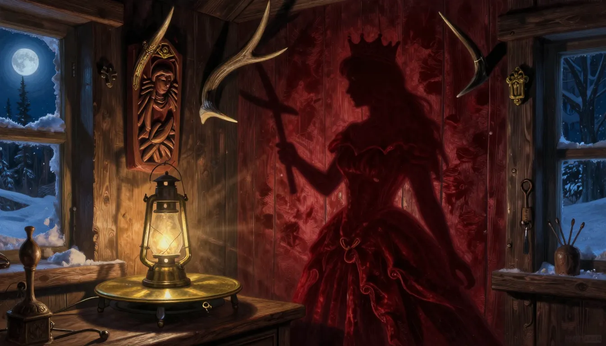
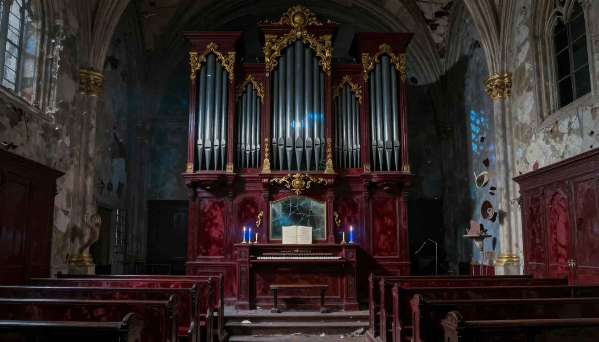
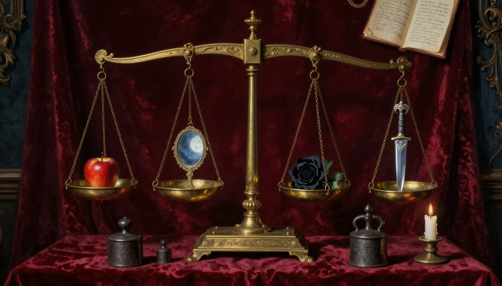
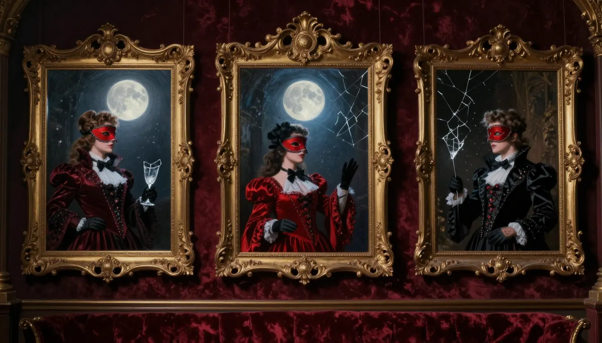
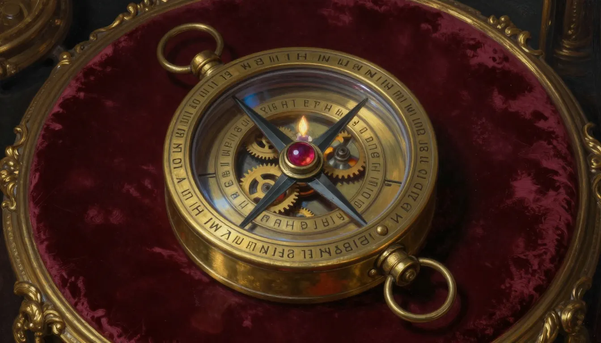

# 《血色魔鏡》鏡淵·下卷企劃（概念圖階段，尚未實作）

- 日期：2026-10-14
- 狀態：**概念圖方向已確認（2026-10-14）。E-X、E6、E7 已實作（見第 5 節）；E8、E9 尚未實作。** 決策：五關全做、E9 之後加小結尾。
- 延續：[`plan-expert-levels.md`](plan-expert-levels.md)（E1–E5 已實作）。沿用其共通規則：四層結構（暖身、並行二選一、合流、小 meta）、三層提示、答錯不重來、鍵盤替代、顏色加形狀第二通道、每個機關附離線求解器證明唯一解或最短解。
- 概念圖：`concepts-next/`（方向稿，不是正式素材）。PNG 母檔放在 `../draft/lucas-lab/blood-mirror/source-art/puzzles/next-batch/`，不進版本控制。E-X 沿用 `concepts-expert/e6_shadow_cabin.webp`。

## 1. 總表

| 關 | 名稱 | 新機關（參考） | 難度（預估） | 首玩 | 美術成本 |
|---|---|---|---|---|---|
| E-X | 影戲小屋（喘息關） | 轉木雕對齊牆上剪影 | 0.50 | 8–10 分 | 低 |
| E6 | 失聲合唱廳 | 管風琴音高比例與節拍 | 0.70 | 12–15 分 | 中 |
| E7 | 稱量廳 | 符號天秤，由等式推重量 | 0.80 | 14–18 分 | 低 |
| E8 | 凝結的三刻 | 三張凍結畫面，辨認六人身分與先後 | 0.88 | 15–20 分 | 高 |
| E9 | 魔鏡羅盤 | 四環連動旋轉 | 0.92 | 15–20 分 | 中 |

順序：E-X、E6、E7、E8、E9。合計約 64–83 分鐘。難度數字都是設計假設，需 3 位真人試玩校正。

## 2. 各關設計

### E-X 影戲小屋

- 旋轉燈前的木雕（兩軸），讓牆上投影對齊目標剪影，容差寬鬆。
- 獎勵：一個「影子」符號，供 E9 使用。
- 技術：Canvas 手算旋轉，零相依。

### E6 失聲合唱廳

- 七根管的音高與管長成反比。玩家要排出指定和弦（3:2、4:3），再依節拍刻痕按順序奏出。
- 每個音高同時顯示成高度條，不靠聲音也能解（聲音只是第二通道）。
- 暖身：兩根管，認識長短與高低。並行：A 排和弦、B 排節拍。合流：用和弦的管奏出節拍。
- 獎勵：一個音名，供 E9 使用。
- 驗證：求解器列舉管的指派，證明和弦與節拍組合唯一。

### E7 稱量廳

- 多台天秤顯示蘋果、鏡、玫瑰、匕首的等式（例如兩個蘋果＝一面鏡），玩家推出各符號的重量，再配出最後一台天秤。
- 暖身：一台天秤，一個未知數。並行：A、B 兩組等式。合流：兩組結果合起來才能配平最後一台。
- 獎勵：一個重量值，供 E9 使用。
- 驗證：求解器保證唯一正整數解。

### E8 凝結的三刻

- 三張凍結畫面（舞會裡摔杯前後的三個時刻），六位賓客。玩家用面具、袖口、位置推理誰是誰、事件先後。
- 一次確認三格，只回「第 k 項說不通」，防暴力試錯。
- 暖身：一張畫面、兩人。並行：A 辨身分、B 排先後。合流：兩者合起來指出摔杯的人。
- 獎勵：一個人名，供 E9 使用。
- 風險：最容易歧義、美術成本最高。**先做一張畫面的原型**，通過手機試玩與成本評估再決定是否保留；每個線索在求解器裡寫成條件，證明唯一解。

### E9 魔鏡羅盤

- 四個同心環，轉一環會按比例帶動鄰環。目標：讓四環的符號對齊。四個符號正是 E-X、E6、E7、E8 的獎勵。
- 暖身：兩環連動。並行：A 環組、B 環組。合流：四環同時對齊。
- 驗證：廣度優先搜尋求最短解，並把步數放寬給玩家。
- 手機操作：必須提供點選加按鈕的替代，不只靠拖曳。

## 3. 小結尾（已確認）
- 完成 E9 後開啟一段短的祕密場景與一個收藏稱號。劇情與稱號文字**實作前另行確認**，並對照 `content/` 稿件，不改寫原著結局。

## 4. 實作前必須先做
1. 量剩餘素材預算（`dist/games` ≤ 26 MB、單張點陣圖 ≤ 500 KB），E4、E5 之後的剩餘量未知。
2. 每關先寫求解器與測試，納入 `npm run check`。
3. 難度數字、時長與歧義都以真人試玩為準，尚無真人試玩。

## 5. 實作紀錄

### E-X 影戲小屋（2026-10-14，已實作，尚無真人手機試玩）
- 機關：`puzzles/shadow.js`。木雕是一組 3-D 球，影子是球的圓盤聯集；由影子反推木雕（影子加上隨機深度，再用解答姿勢的反向旋轉擺開），所以只有一個視角正確。比對用 34×34 格的交集比（IoU ≥ 0.9）。
- 兩道機關：鑰匙（只轉水平角，扁平木片）、戴冠的女人（水平角加前後傾斜，立體）。第二道要等第一道完成（`after`）。
- 求解器（`scripts/blood-mirror-abyss.test.mjs`）：鑰匙在水平角 120–160 度的一段內有解（9 個格點），背面鏡像與起始姿勢不通過；女人只有解答周圍相鄰的 3 個姿勢通過，鏡像視角、單轉一軸都不通過。
- 操作：兩個範圍滑桿（鍵盤方向鍵與觸控都可用，每步 5 度）；沒有動畫迴圈，所以減少動態設定不需要另一條路。
- 提示：每步三層（遠、近），第三層寫出角度。
- 清單位置：加在關卡清單的最後（`e1`…`e5`、`ex`），沒有插在 E2 與 E3 之間，因為既有測試與程式用索引取關卡；這與原企劃「放在 E2 與 E3 之間」不同。
- 台詞：全部取自 `expert-dialogue-draft.md` 3.6 節。獎勵「剪影木片」的記號 `影` 供 E9 使用（E9 尚未實作）。
- 美術：兩張橫幅與縮圖（本機 Z-Image Turbo），見 `MEDIA_ASSETS.md`；首屏請求數不變（機關為延後載入）。

### E6 失聲合唱廳（2026-10-14，已實作，尚無真人手機試玩）
- 機關：`puzzles/choir.js`。三道機關，前兩道可任意順序，第三道要等前兩道（`after`）。
  - 管長與音高：先在三根管選八度（長 6 與 12），再在七根管選和弦。音高與管長成反比，和弦音高比 4：5：6，所以管長比是 15：12：10，答案是長 10、12、15。長 8、10、12 的管長比是 4：5：6，是刻意放的陷阱（回饋會說「管長的比對了，可是音高和管長是反的」）。
  - 三個聲部：高音每 3 拍、中音每 4 拍、低音每 6 拍，轉動各自的起拍，疊起來要等於樂譜上刮出的 12 拍。答案是起拍 2、3、4（第幾拍）。
  - 聖歌：聲部越慢，管越長；寫出前 10 拍每拍打開哪幾根管。需要前兩道的結果。答錯只回「第 k 拍有地方不對」。
- 全程無聲：沒有使用 Web Audio，合唱廳「失聲」；音高只用管長與高度條呈現。這也避開音訊與靜音設定的耦合。
- 求解器（`scripts/blood-mirror-abyss.test.mjs`）：八度、和弦、起拍各只有一個答案；陷阱組不通過；聖歌答案對任何一個聲部的起拍或管對應都很敏感，所以前兩道的結果都是必要的。
- 操作：管與樂譜格都是 44px 以上的按鈕，沒有拖曳；沒有動畫迴圈。
- 清單位置：加在 E-X 之後（`e1`…`e5`、`ex`、`e6`）。
- 台詞：新增在 `expert-dialogue-draft.md` 3.7 節（開場 3 句、解封 3 句），已通過 `expert-dialogue.check.cjs`。獎勵「銅片」的記號 `音` 供 E9 使用。
- 美術：三張橫幅與縮圖（本機 Z-Image Turbo），見 `MEDIA_ASSETS.md`；首屏請求數不變（機關為延後載入）。
- 實測時修正過一個 bug：暖身通過後沒有重置完成旗標，第二關的按鈕全被擋掉。

### E7 稱量廳（2026-10-14，已實作，尚無真人手機試玩）
- 機關：`puzzles/scale.js`。蘋果、鏡、玫瑰、匕首各有整數重量（2、3、5、7 磅），帳頁上只有平衡的天秤與已知重量的鐵砝碼。三道機關，前兩道可任意順序，第三道要等前兩道（`after`）。
  - 蘋果與鏡：三個蘋果＝兩面鏡；一個蘋果加一面鏡＝5 磅。配平「四面鏡＝？個蘋果」，右盤只能放蘋果，答案 6 個。
  - 玫瑰與匕首：匕首＝玫瑰加 2 磅；兩朵玫瑰加一把匕首＝17 磅。配平「五把匕首＝？朵玫瑰」，答案 7 朵。
  - 最後一台：左盤五面鏡加兩朵玫瑰（25 磅），右盤剛好六件，只能用蘋果、鏡、匕首，答案 1 個蘋果、3 面鏡、2 把匕首。前兩頁收在「翻回前兩頁帳頁」摺疊裡，可以回頭看。
- 求解器（`scripts/blood-mirror-abyss.test.mjs`）：每組等式在 1–12 磅內只有一組重量，少任何一條等式就不唯一；三台開放天秤各只有一種右盤擺法；若任何一個重量錯，最後一台就配不平。
- 回饋：只說「天秤沒有平衡」或「右盤要剛好放 6 件」，不指出哪邊重，避免逐步逼近。
- 符號除了顏色還有形狀（圓形蘋果帶梗葉、橢圓鏡帶柄、旋紋玫瑰、尖刃匕首）；加減鈕與步進列都在 44px 以上；沒有動畫迴圈。
- 清單位置：加在 E6 之後（`e1`…`e5`、`ex`、`e6`、`e7`）。
- 台詞：新增在 `expert-dialogue-draft.md` 3.8 節（開場 3 句、解封 3 句），已通過 `expert-dialogue.check.cjs`。獎勵「鉛砝碼」的記號 `重` 供 E9 使用。
- 美術：三張橫幅與縮圖（本機 Z-Image Turbo），見 `MEDIA_ASSETS.md`；首屏請求數不變（機關為延後載入）。
